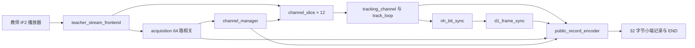

# 北斗 B1I 接收机当前 RTL 架构

修订日期：2026-10-13；实现基线：2556e76。完整设计说明见 [总体架构报告](./北斗B1I基带处理器_总体架构方案.md)，三份模块报告及源码索引见 [验收材料](../模块实验报告/验收文件索引与讲解提纲.md)。

## 数据流与入口

实际入口 `rtl/student_receiver_core.sv` 设置 DIRECT_SAMPLES=1、PUBLIC_RECORDS=1、AUTO_SCAN=1。新版教师包默认位于 `student_release1/student_release/`，STREAM_MODE=2、TAG_STRIDE=16。每次传输为 16 样本，[1:0] 最早，传输标签步长 16；文件每字节仍高位优先，播放器已转换排列。详见 [输入更新说明](../../docs/TEACHER_STREAM_UPDATE.md)。

## 模块分工

| 功能 | 实际文件 |
| --- | --- |
| 输入适配与时基 | rtl/common/teacher_stream_frontend.sv；sample_timebase.sv |
| 捕获与测距码 | rtl/acq/acquisition.sv；rtl/common/prn_code_gen.sv |
| 自动遍历与通道生命周期 | rtl/ctrl/channel_manager.sv |
| 跟踪及统一环路 | rtl/track/tracking_channel.sv；track_loop.sv |
| NCO、码表与相关 | rtl/track/code_nco.sv；carrier_mixer_nco.sv；code_ram.sv；correlator_epl.sv |
| NH 与 D1 | rtl/sync/nh_bit_sync.sv；d1_frame_sync.sv |
| 通道封装与公共编码 | rtl/track/channel_slice.sv；rtl/meas/public_record_encoder.sv |

顶层保留 SRAM 和字节输入及内部记录路径，当前教师包装模块使用上表的直接样本和公共编码路径。RINEX 转换、星历完整解释和浮点定位属于配套软件，不列为当前公共入口的必经 RTL 模块。

## 并行结构与时序

共享捕获引擎默认 64 路相关、33 024 样本缓存。4096 半码片槽位覆盖 4092 个有效假设，末端重复位置按周期回绕；粗判后执行 5 个细频点。通道管理器自动遍历 PRN 1～63，跳过已占用编号，命中后装载码表并移交。追赶及初始化暂停输入，移交状态对应最后已处理样本。

12 路通道具有独立状态，载波相位 32 位、码相位 48 位 Q11.37、E／P／L 六路相关量 26 位。DLL、FLL、PLL 集成在 track_loop 内，环路乘法按步骤复用；完整窗口 j 的反馈用于窗口 j+2。源代码复用不表示所有通道物理共用一份载波 ROM，实际映射须以综合为准。

## 时间与记录

实际样本计数在单样本 valid／ready 握手时增加，空拍不增加时间。本地码 NCO 回绕形成积分窗口，首个不完整窗口不更新环路。NH 位结束标签传入 D1 的 311×144 bit 元数据历史，每字采用最后一位的真实结束样本数和码相位，避免下一前导码造成的 220 ms 译码等待偏差。

public_record_encoder 输出 TRACKING、NAVIGATION、STATUS、COMMON_OBSERVATION、ACQUISITION、END 六类 256 位记录。公共历元按 16 368 000 个实际样本快照；输出等待握手时保持稳定，并向输入施加背压。输入结束后停止新搜索，排空内部结果与队列，输出唯一 END。

## 当前验证与边界

2026-10-13 ModelSim 回归 20／20 PASS；独立播放器检查比较 262 160 个样本，跨 64 KiB 边界且含背压。短流输出仅 1 条 END。导航位向量 RTL 用例恢复 5 子帧、50 NAV，并经新版教师工具检查；历史公开软件参考为六星 96 子帧。证据保存在 `deliverables/模块实验报告/验证资料_20261013/`，原曲线和软件证据保留在 `验证资料_20261012/`。

完整 100 s 公开采样的当前 RTL 六星自主接收和目标工艺综合尚未完成。D1 当前缺少相邻 SOW／FraID 连续性确认及长期缺帧撤销锚点机制。12 通道结构、短流接口通过、软件全量结果均不能替代完整 RTL 信号验收。
