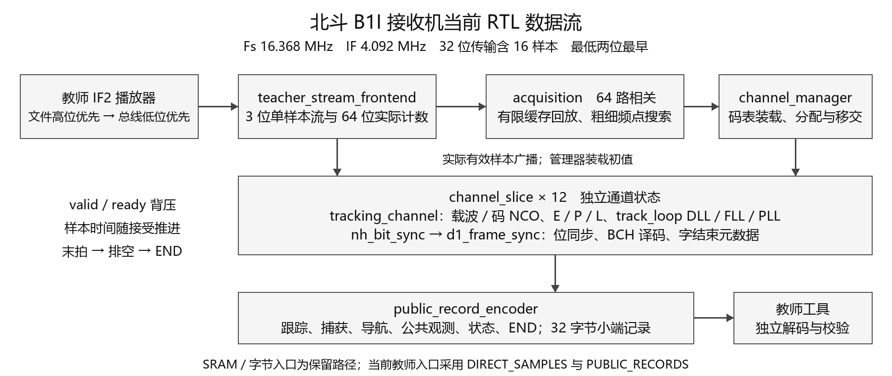

# 北斗 B1I 基带处理器总体架构方案

版本：2.1　修订日期：2026-10-13　RTL 实现基线：2556e76

本方案说明北斗 B1I 接收机的实际 RTL 结构、输入输出、模块分工、控制时序及验证范围，作为三份模块实验报告的总体设计依据。当前实现以教师采样流为入口，采用共享捕获引擎和 12 路独立处理通道，完成码与载波跟踪、NH 位同步、D1 译码及公共记录输出。模块回归与短流接口联调已经通过；完整公开 100 s 采样经过当前 RTL 的六星接收结果，以及目标工艺综合结果，仍需进一步验证。

## 0 文档依据与参数基线

参数来自新版教师包 `student_release1/student_release/` 的输入契约、接口定义和输出规范。接口修订改变了总线排列及传输标签步长，IF2 文件内容保持一致。下表所列采样参数是当前实验条件。

| 参数 | 当前值 |
| --- | --- |
| 信号与采样 | B1I 实数中频；Fs=16.368 MHz；IF=4.092 MHz |
| 量化与映射 | 每样本 2 bit；00→−3，01→−1，10→+1，11→+3 |
| 测距码 | 2046 chip；2.046 Mchip/s；每码片 8 样本 |
| 积分与电文 | 标称 1 ms 为 16 368 样本；NH20；D1 50 bit/s |
| 公开数据 | 静态六星；100 s；409 200 000 字节；1 636 800 000 样本 |

## 1 系统输入输出定义

教师入口为 `rtl/student_receiver_core.sv`。默认 STREAM_MODE=2、TAG_STRIDE=16；32 位 stream_data 含 16 个连续样本，[1:0] 最早，[31:30] 最晚。sample_index 每次传输递增 16。IF2 文件每字节仍以 [7:6] 为最早采样，播放器已转换为总线排列，接收机不得再次执行字节内重排。

| 接口组 | 定义与使用条件 |
| --- | --- |
| 启动与复位 | clk、reset_n、start；一次输入会话结束后须复位再启动 |
| 输入流 | stream_data[31:0]、stream_valid、stream_ready、stream_last、sample_index[63:0] |
| 输出流 | record_data[255:0]、record_valid、record_ready；每记录 32 字节，小端输出 |
| 握手 | valid 与 ready 同时有效时接收；等待期间数据及末拍标志保持稳定 |

接收路径仅使用样本及公开参数。合成激励真值由测试台用于评价，不进入 RTL；教师原始占位模块不参与实际接收机编译。当前教师规范要求 receiver_records.bin，RINEX 转换属于后续软件处理范围。

<!-- pagebreak -->

## 2 架构设计

### 2.1 总体数据流



输入前端将总线转换为带握手的 3 位有符号单样本流。共享捕获引擎读取有限缓存，完成码相位及多普勒搜索；通道管理器装载对应码表，将带参考时刻的初值移交给空闲通道。各 channel_slice 包含跟踪、NH 位同步和 D1 帧译码。公共编码器汇集相关观测、导航字、公共历元及状态事件，排空后输出唯一 END。

### 2.2 分层与职责

| 层次 | 实际模块及职责 |
| --- | --- |
| 输入与时基 | teacher_stream_frontend、sample_timebase；检查传输标签，统计实际接受样本 |
| 搜索与调度 | acquisition、prn_code_gen、channel_manager；后台搜索、码表装载、通道生命周期 |
| 通道处理 | channel_slice×12；独立 NCO、E／P／L 相关、统一环路、NH 和 D1 状态 |
| 公共输出 | public_record_encoder；32 字节格式、事件排队、一秒边界快照、背压与 END |

### 2.3 关键架构决策

捕获采用默认 64 路码相位并行相关，跟踪通道按样本并行运行；环路滤波在每个通道内部串行复用乘法运算。代码表和载波查表由对应实例使用，源代码复用不等于全芯片只有一份物理 ROM。SRAM 和字节输入保留为 b1i_rx_top 的其他输入路径，当前教师包装模块采用 DIRECT_SAMPLES=1、PUBLIC_RECORDS=1、AUTO_SCAN=1。

<!-- pagebreak -->

## 3 模块划分

| 设计职责 | 仓库内主要文件 |
| --- | --- |
| 教师输入与实际入口 | rtl/student_receiver_core.sv<br>rtl/common/teacher_stream_frontend.sv |
| 整机连接与配置 | rtl/b1i_rx_top.sv<br>rtl/include/b1i_params.svh |
| 码生成与捕获 | rtl/common/prn_code_gen.sv<br>rtl/acq/acquisition.sv |
| 通道管理 | rtl/ctrl/channel_manager.sv |
| 跟踪通道与统一环路 | rtl/track/tracking_channel.sv<br>rtl/track/track_loop.sv |
| NCO 及相关器 | rtl/track/carrier_mixer_nco.sv；code_nco.sv<br>rtl/track/code_ram.sv；correlator_epl.sv |
| 位同步与 D1 译码 | rtl/sync/nh_bit_sync.sv<br>rtl/sync/d1_frame_sync.sv |
| 通道封装与公共记录 | rtl/track/channel_slice.sv<br>rtl/meas/public_record_encoder.sv |

## 4 各模块关键信号

输入前端输出 sample、sample_valid、sample_last，并由 sample_ready 控制消费；sample_count 为 64 位实际样本总数。输入异常通过 input_error 和 missing_ticks 传递。捕获使用 start／done／found／ready／ack 约束任务提交与移交，input_pause 使追赶和通道初始化期间停止接受新样本。

| 接口或状态 | 语义 |
| --- | --- |
| init_load、clear、enable | 装载初值、撤销旧状态、使能通道；由通道管理器控制 |
| dump_valid、dump_partial | 本地码周期相关结果；首个不完整窗口不进入环路更新 |
| E／P／L 的 I／Q | 六个 26 位有符号相关量；Prompt I 进入 NH 相关 |
| bit_valid、bit_end_sample／phase | 已判数据位及其真实结束样本与 48 位码相位 |
| sf_valid、sf_info／raw | 224 位恢复信息、300 位极性校正原始子帧及逐字纠错统计 |
| sf_word_samples／phases | 10 个导航字的真实结束状态，供公共格式编码 |

通道代次 generation 在内部为 8 位，重新分配时递增。不同公共记录格式保留的代次位宽由具体字段定义决定，其中版本 3 跟踪记录保留低 6 位；验收解析必须采用相应 schema，不可将所有类型一概解释为 8 位。

<!-- pagebreak -->

## 5 控制器状态机

### 5.1 通道管理器

channel_manager 的调度状态为 S_IDLE、S_PICK、S_GEN_ACQ、S_ACQ_GO、S_ACQ_WAIT、S_ALLOC、S_GEN_CH、S_HANDOVER 和调试用 S_FORCE_GEN。自动搜索依次检查 PRN 1～63，跳过已占用卫星；命中后选择空闲通道，完成码表生成和移交。输入结束后停止启动新的搜索任务。

### 5.2 每通道生命周期

| 状态 | 主要转移条件 |
| --- | --- |
| CH_IDLE | 分配和初始化后进入 CH_PULLIN |
| CH_PULLIN | 锁定后进入 CH_TRACK；拉入超时则清除并释放 |
| CH_TRACK | 失锁后进入 CH_LOST；位／帧同步超时可产生状态事件 |
| CH_LOST | 恢复锁定返回 CH_TRACK；持续失锁超时则释放 |

默认拉入、失锁保持、位同步超时均为 2000 ms，帧同步超时为 34000 ms。位／帧超时事件的产生不等价于 D1 时间锚点自动失效；当前帧译码器缺少长期缺帧撤销锚点的完整机制，需单独完善。

### 5.3 捕获控制与相关窗口

捕获顺序为缓存采集、每轮延迟预热及回放相关、槽位统计、频点切换、粗搜索判决、细频点搜索、相位外推、追赶和结果移交。实际状态包括 S_CAPTURE、S_PASS_LOAD、S_PASS_RUN、S_SCAN、S_NEXT、S_DECIDE、S_PROP_MUL、S_PROP_RED、S_CATCHUP 和 S_READY；结束与应答通过 S_DONE／ack 管理。

跟踪积分仅处理有效样本，并以码回绕形成 dump。首次部分窗口仅用于观测。完整窗口 j 的相关结果驱动串行环路计算，反馈用于窗口 j+2；该延迟已在定点参考模型和测试向量中体现。

## 6 接口规范与异常处理

输入输出均遵循 valid／ready 握手，时钟空拍不增加样本时间。输出背压沿编码器和整机 input_ready 传回播放器，禁止在等待期间重复统计数据。前端检测传输标签间隙、重复或倒退，并保持错误状态；配置不匹配不得解释为合法信号结果。

clear 撤销通道环路、NH 历史、D1 译码及待提交状态，防止旧代次数据进入新通道。输入最后一个样本接受后，顶层等待内部处理及记录队列排空，再产生唯一 END；运行脚本以 END 和独立记录校验作为完成条件。

<!-- pagebreak -->

## 7 验证与验收对应

### 7.1 当前验证证据

| 验证层次 | 实测结果 | 结论范围 |
| --- | --- | --- |
| RTL 回归 | 20／20 PASS | 模块及系统定向用例；ModelSim SE-64 10.5 |
| 捕获与移交 | PRN 10 检出；PRN 6 拒判 | 650 ms 两星合成场景；移交后 300 ms 锁定，码误差 0.0058 chip |
| 单通道跟踪 | 300 个 dump；4800 比较；0 不一致 | 给定定点向量下闭环行为与参考模型一致 |
| NH／D1 | 59 位正确；5 子帧；50 NAV | 给定相位、误码及极性激励；教师独立 BCH 检查通过 |
| 新版播放器 | 262 160 样本逐一一致 | 65 540 字节，跨越 64 KiB 缓冲边界，含背压；短流输出仅 1 条 END |
| 兼容及反例 | 旧版短流 BIN 与新版一致；错模式拒绝 | 验证排列与配置检查；不代表长流信号性能 |
| 软件参考 | 六星 96 子帧，960 导航字 | 已保存的 100 s 浮点软件实验，本次复核；与 RTL 证据分别列示 |

2026-10-13 的回归日志头保留生成时版本 dfaeb88 和工作区有修改的标记；被测源码随后提交为 2556e76。报告采用后者描述实现基线，保留原日志以便追溯，未改写其版本来源。软件参考和 2026-10-12 的曲线也保留原实验日期。

### 7.2 新版输入顺序独立检查

tb_teacher_player_order 直接读取 IF2 文件，按文件内高位优先顺序生成参考样本，再与播放器驱动的实际 RTL 前端输出逐样本比较。比较过程独立于总线重排公式，并检查传输标签、末拍、背压稳定性及总数。错误地把新版播放器配置为旧版排列时，在第 2 个样本即检出不一致并停止接收机运行。

新旧公开 IF2 文件的 SHA256 均为 2c47d1533fa54316952496ffb7905742c34a989b0a6276b867fe69566c5027da。新旧短流输出均为 32 字节 END 记录；因此二进制一致只说明短流计数和结束行为相容，不能说明两者完成了相同的卫星接收过程。

### 7.3 验收材料与讲解依据

三份模块报告分别覆盖捕获、DLL／FLL／PLL 以及位同步／导航解调。最新 RTL 与播放器证据保存在 `deliverables/模块实验报告/验证资料_20261013/`，既有曲线和软件复核资料保存在 `验证资料_20261012/`。验收文件索引逐项对应模块源码、测试台、运行命令和结果说明。

<!-- pagebreak -->

## 8 架构补充分析

### 8.1 输入吞吐与缓存

教师接口每次传输 16 个样本，前端按内部接受节拍逐样本消费。捕获计算可回放缓存，跟踪使用持续输入；当追赶、初始化或输出队列需要等待时，整个输入会暂停。该机制适用于可回压的文件播放器。若以后改为不可暂停的实时 ADC，须另行设计弹性缓存和丢样策略，并证明最坏停顿条件下的吞吐。

捕获缓存默认深度 33 024、每样本 3 位，存储数据量为 99 072 bit。该数值是逻辑容量，不包括地址、控制及相关器，也不等价于工艺映射后的 SRAM 面积。

### 8.2 主要状态与存储预算

| 资源项 | 逻辑容量或位宽 | 说明 |
| --- | --- | --- |
| 捕获缓存 | 33 024×3 bit | 有限回放缓冲；默认配置 |
| 每通道码表 | 2046×1 bit | 12 通道独立码表；另有捕获码表 |
| 每通道相关器 | 6×26 bit | E／P／L I／Q 累加；不含 NCO 与环路状态 |
| 每通道 NH | 20×26 bit 历史；20×40 bit 分数 | 另有串行相关运算及控制 |
| 每通道 D1 元数据 | 311×144 bit | 64 位样本数＋48 位码相位＋32 位码周期标签 |
| 每通道码 NCO | 48 位 Q11.37 | 标称增量 2^34；周期 2046×2^37 |

启用 WITH_METADATA 时，单通道 D1 元数据为 44 784 bit，12 通道合计 537 408 bit；原始位历史和输出队列另计。这一部分不可从总体面积分析中省略。载波 ROM 的物理共享、存储宏映射及逻辑优化程度须根据综合报告确定，目前不提供“全芯片一份 ROM”或固定面积缩减比例的结论。

1 ms 最大相关绝对上界按 16 368×3×512=25 141 248 估算，26 位有符号数可覆盖；20 ms 求和上界为 502 824 960，32 位相关和具有余量。这是所列标称窗口的幅值分析，不包含长时间失配导致窗口延长的额外条件。

<!-- pagebreak -->

### 8.3 跟踪定点结构与反馈时序

carrier_mixer_nco 使用 32 位载波相位和 10 位查表幅值，形成 13 位混频结果。码相位内部采用 48 位 Q11.37，对外保留高 32 位 Q11.21 兼容字段。默认 E／L 位于 Prompt 两侧各 0.5 chip。track_loop 使用 Prompt 幅度平滑和倒数查表归一化，DLL 系数为 Q8.8，PLL／FLL 系数为 Q2.14，并对积分状态限幅。

环路滤波共享乘法运算按状态逐步执行；载波辅助码率还包含独立常数乘法。运算移位及饱和须与定点模型一致，不能按浮点公式忽略截位次序。完整积分窗口反馈的两个窗口延迟应在稳定性和收敛分析中保留。

### 8.4 同步状态与时间有效性

NH 位同步对 20 个候选起点累计绝对相关分数，默认累计 200 次有效候选更新后，以最佳非零且不小于次佳两倍作为同步条件。D1 使用间隔 300 bit 的两处同极性前导码，处理 19 个受保护 BCH 码字并检查 FraID 和 SOW 范围。

当前 frame_synced 和 anchor_valid 表示已获得符合现有条件的子帧，尚不包含相邻子帧 SOW 加 6 s、FraID 循环一致以及长期缺帧自动失效的完整确认。BCH(15,11) 每码字可纠正单错，多错可能误纠；校验通过不构成可靠双错检测证明。

### 8.5 捕获移交与导航时间戳

捕获搜索得到的相位属于缓存参考时刻。移交前按已推进样本数将其外推至当前时刻，外推包含标称码率和多普勒辅助项；S_CATCHUP 暂停输入以消化剩余间隔，S_READY 给出对应最后已处理样本的状态，随后装载通道并继续处理。

导航子帧的确认须等待下一前导码 11 bit，译码启动因此比前一子帧结束晚 220 ms。NH 模块在数据位结束时保留样本数和码相位，D1 通过历史缓存读取各字最后一位的实际状态；公共导航记录采用这些元数据，不以译码完成时刻代替导航字结束时刻。

公共历元按实际样本计数的 1 s 边界快照，标称边界间隔为 16 368 000 个样本。公共历元测试在边界附近预置计数验证快照，属于边界功能验证；完整 1 s 或 100 s 的原始数据吞吐仍需独立运行证明。

<!-- pagebreak -->

## 9 后续验证与复现入口

### 9.1 待完成的验证

完整公开文件的自主捕获、连续多通道跟踪、位同步和导航输出需要在当前 RTL 上完成，并由教师工具检查成功捕获、锁定记录、导航字、公共观测及最终样本数。当前 12 通道是结构配置，尚不能解释为已同时接收 12 颗卫星。

下一步应补充不同载噪比、频差及噪声种子的捕获检出率／虚警率，全部 NH 相位、连续帧确认、多误码和缺帧失效策略，以及不可暂停输入情况下的缓存预算。目标工艺、标准单元库、存储宏和时钟约束确定后，再进行 DC 综合、面积和时序评估。虚拟机工具连通性验证与最终设计综合结论分别记录。

### 9.2 当前可复现命令

以下命令在项目根目录执行，Python 使用已配置解释器，RTL 仿真选择已安装的 ModelSim／Questa。

```text
python scripts/run_rtl_unit.py --sim modelsim
python scripts/test_teacher_release.py
python scripts/run_teacher_receiver.py --max-bytes 65540
    --stall-period 7 --output reports/sim/teacher_demo.bin
python scripts/validate_teacher_records.py
    deliverables/模块实验报告/验证资料_20261013/public_navigation.bin
    --expected-samples 732076990
```

上述跨行命令为参数示意，实际 PowerShell 完整可执行命令见验收索引。短流演示先独立核对文件采样顺序，再运行接收机；输出仅 END 属于该试验的预期验证范围。完整信号验收应另用 `--require-signal-results`，并提供足够的真实输入时长。

### 9.3 配套材料

| 材料 | 文件位置 |
| --- | --- |
| 三份模块 Word 及 Markdown | deliverables/模块实验报告/01、02、03 对应报告 |
| 实现文件与现场讲解 | deliverables/模块实验报告/验收文件索引与讲解提纲.md |
| 教师接口修订说明 | docs/TEACHER_STREAM_UPDATE.md |
| 接口和定点依据 | docs/INTERFACES.md；docs/FIXED_POINT.md |
| 回归与独立播放器检查 | scripts/run_rtl_unit.py；scripts/run_teacher_receiver.py |
| 架构维护与编译清单 | scripts/build_arch_report.py；rtl/filelist.f；tb/filelist.f |

本报告依据新版教师输入／输出规范、现行源码和已保存的仿真证据修订。三份模块报告进一步给出算法、实验条件、数值结果和图表；架构文档与模块报告对软件参考、模块 RTL、短流联调和全量验收采用一致的范围定义。
