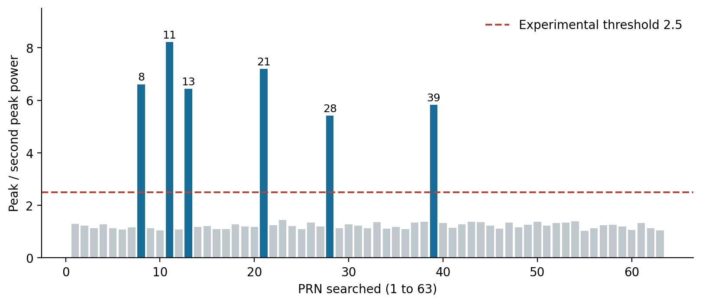
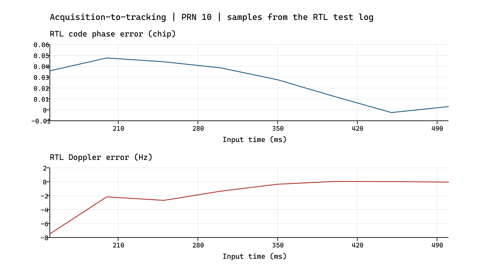
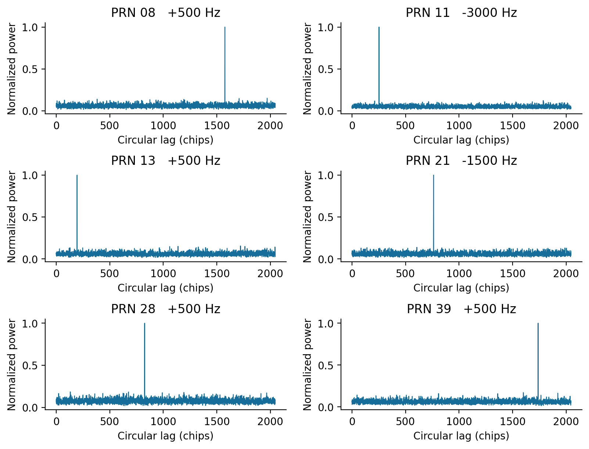

# 北斗 B1I 捕获模块设计与仿真报告

项目组实验报告 · 2026-10-13 · 版本 2.1

摘要：设计实现了 64 路码相位并行相关、粗细多普勒搜索及带时间外推的捕获移交。合成 RTL 用例成功检出 PRN 10，拒判缺席 PRN 6，并在移交后进入闭环锁定；公开数据的独立软件参考从 63 个 PRN 中检出六颗卫星。报告分别给出实现方案、实验条件、仿真结果及其验证范围。

## 1 设计目标与输入条件

捕获模块在未知卫星信号的条件下搜索测距码编号、码相位和多普勒频率，并向跟踪通道提供具有明确参考时刻的初始状态。设计采用共享捕获引擎与多通道管理器协同工作，以减少重复搜索电路，同时支持已捕获卫星的连续跟踪。

| 参数 | 实验条件 |
| --- | --- |
| 输入文件 | student_release1/student_release/input/scenario.if2 |
| 采样率与中频 | 16.368 MHz；4.092 MHz；实数中频 |
| 样本量化 | 00 → −3，01 → −1，10 → +1，11 → +3 |
| 测距码 | 2046 chip／周期；2.046 Mchip/s；标称周期 1 ms |
| 二次码与数据率 | NH20；D1 导航电文 50 bit/s |
| 公开场景 | 静态六星；100 s；标称 C/N₀ 为 40 dB-Hz |

公开输入文件包含 409 200 000 字节，即 1 636 800 000 个实际样本。接收机处理路径仅使用采样流及公开接口参数；合成用例的信号真值由测试台用于评价误差，不进入被测 RTL。

公开输入 SHA256：2c47d1533fa54316952496ffb7905742c34a989b0a6276b867fe69566c5027da

本报告以 RTL 版本 2556e76 为实现基线。2026 年 10 月 13 日 ModelSim SE-64 10.5 回归 20／20 通过；既有图表与软件参考保留原实验来源。新版输入契约和独立联调证据见附录，原始日志版本标记保持不变。

## 2 测距码生成与相位约定

B1I 测距码由两个 11 级线性反馈移位寄存器生成，初始状态均为 01010101010。G1 反馈级为 1、7、8、9、10、11；G2 反馈级为 1、2、3、4、5、8、9、11。卫星码由 G1 第 11 级输出与所选 G2 抽头异或形成，每输出 2046 个码片完成一轮码表生成。

当前码发生器支持 PRN 1～63。PRN 1～37 的相位分配依据 B1I ICD 2.1；扩展编号的三抽头分配在参考模型中注明交叉核对来源。码生成结果写入捕获及跟踪所使用的可加载码存储器。软件相关延迟与本地 NCO 相位采用不同符号约定，移交时必须依据同一参考样本进行转换。

## 3 RTL 捕获技术方案

### 3.1 并行相关结构

acquisition.sv 由采样缓存、载波下变频、码延迟抽头、并行相关器、粗细搜索控制及移交 NCO 构成。默认设置为 64 路并行相关与 33 024 样本回放缓冲。每一频点分 64 轮回放；各路相邻假设相差半个码片，即 4 个原始样本。硬件按 4096 个槽位组织扫描，覆盖一个码周期的 4092 个半码片位置，末端 4 个槽位按周期回绕。

每轮先使用 252 个样本填充码延迟线，再进行 1 ms 相干积分。nc 可设为 1 或 2，相邻相干窗口的幅度近似值再非相干累加。下式中 N=16368，m 为相干窗口编号，h 为码相位假设，c 为 ±1 本地码。采样缓存采用同步读结构；码相位、载波相位与积分计数仅在相应有效样本被处理时推进。

I(m,h) = Σ x[n] c(h)[n] cos θ[n]

Q(m,h) = −Σ x[n] c(h)[n] sin θ[n]

### 3.2 搜索配置与捕获判决

| 配置项 | 顶层默认值 | 本次定向用例 |
| --- | --- | --- |
| 码相位并行度 | 64 路 | 64 路 |
| 粗频点 | 41 点；约 −10～+10 kHz | 5 点；−500～+1500 Hz |
| 粗频率步长 | 约 500 Hz | 约 500 Hz |
| 相干与非相干积分 | 1 ms × 1 | 1 ms × 2 |
| 幅度峰均比门限 | Q4.4 值 40，即 2.5 | Q4.4 值 56，即 3.5 |

A(h) = Σ (|I(m,h)| + |Q(m,h)|/2)；Amax > τ Amean

峰值频点的均值由该频点 4096 个槽位统计量之和右移 12 位得到。RTL 采用幅度峰均比，软件参考采用功率峰次峰比，两种门限不能直接互换。粗搜索判决通过后，在峰值附近执行 5 个细频点搜索，步长为粗步长的四分之一，默认约 125 Hz。该门限属于当前开发配置，尚未据统计试验标定虚警概率。

## 4 捕获状态向跟踪通道移交

码相位搜索结果属于采样缓存的参考时刻。捕获计算期间输入流仍可能继续推进，因此直接装载搜索初相会产生时间偏差。设计记录从缓存起点至当前已处理样本的间隔 Δ，并将码相位外推至移交时刻；外推量同时包含标称码率和由多普勒估计得到的载波辅助项。

φho = [h·2³⁶ + Δ(2³⁴+a)] mod (2046·2³⁷)

其中 h 为半码片假设，a 为以 48 位码 NCO 增量表示的载波辅助修正。外推后进入追赶状态，并通过 input_pause 暂停新输入以消化待处理间隔；ready 有效时输出状态对应最后一个已处理样本。通道管理器完成码表装载后发出初始化脉冲，并在该时段暂停输入，避免在初始化拍丢失样本。

## 5 RTL 仿真设置与结果

tb_acquisition 使用独立信号发生模型产生 650 ms 两星中频输入，其中目标为 PRN 10、干扰卫星为 PRN 28，目标 C/N₀ 为 45 dB-Hz；同时搜索不存在的 PRN 6。该用例以给定的 5 个频点进行定向验证，重点检查相关搜索、相位外推、移交及后续闭环跟踪。

| 观测项 | 仿真结果 |
| --- | --- |
| 目标捕获 | found=1；h=3192；多普勒频率字 65600 |
| 捕获判决统计量 | 峰值 1 013 221；均值 210 098；峰均比约 4.82 |
| 移交时刻 | 累计 1 791 804 样本处捕获完成；约 109 ms 移交 |
| 移交后跟踪 300 ms | locked=1；码相位误差 0.0058 chip |
| 不存在的 PRN 6 | found=0；峰均比约 3.16，小于用例门限 3.5 |

本次 20 项 RTL 回归全部通过，其中 tb_prn_code_gen、tb_auto_scan、tb_channel_manager 和 tb_acq_input_pause 分别检查码发生、遍历与通道分配、生命周期及输入暂停。上述结果表明对应功能在所列激励下成立；不存在信号的单次拒判不能替代虚警率测量。

## 6 公开 IF2 数据的软件参考实验

软件参考使用公开文件起始 10 ms 数据，对 PRN 1～63 执行完整粗搜索；多普勒范围为 −10～+10 kHz，步长为 500 Hz。利用中频为采样率四分之一的关系，以 1、−j、−1、j 序列下变频，再将相邻 4 个复样本相加，得到等效采样率 Fd=4.092 MHz 的基带序列。各频点用 FFT 圆相关一次计算 4092 个码延迟假设，并将 10 个独立 1 ms 窗口的相关功率非相干累加。

Rm = IFFT{FFT[xm·exp(−j2πfn/Fd)]·conj(FFT[c])}；Fd=Fs/4

软件以峰值功率与排除峰值附近 ±2 个降采样点后的次峰功率之比进行判决，门限取 2.5。粗搜索后在原采样率上对最佳延迟附近 ±4 个样本重新相关，细化分辨率为 0.125 chip。2026 年 10 月 12 日复核执行该 10 ms 搜索，相关矩阵与保存的 acquisition_maps.npz 逐元素完全一致。

| PRN | 粗多普勒 Hz | 循环延迟 样本 | 功率峰次峰比 |
| --- | --- | --- | --- |
| 8 | +500 | 12603 | 6.61 |
| 11 | -3000 | 2024 | 8.22 |
| 13 | +500 | 1563 | 6.44 |
| 21 | -1500 | 6099 | 7.19 |
| 28 | +500 | 6611 | 5.41 |
| 39 | +500 | 13909 | 5.82 |

图 1　公开数据 10 ms 软件参考的 PRN 搜索与功率峰次峰比

软件检出 PRN 8、11、13、21、28、39。其后续导航记录已通过教师独立译码校验，为检出信号的可跟踪、可解调性提供了补充依据。这些结果属于软件参考实验，不能据此认定 RTL 已完成 100 s 六星自主接收。

## 7 仿真结果分析

### 7.1 RTL 捕获移交的闭环行为

图 2　PRN 10 合成 RTL 用例的移交后误差；曲线连接日志中的 8 个采样点

捕获移交后，码相位误差维持在 0.05 chip 以内，并在约 400 ms 输入时刻进入锁定状态。用例在移交后 200 ms 关闭 FLL 辅助，至跟踪 300 ms 时码误差为 0.0058 chip。该结果检验了捕获与跟踪之间的相位符号、参考时刻及状态装载关系；其有效范围为该合成输入及相应环路配置。

### 7.2 软件相关功率峰的分析

图 3　六颗检出卫星在最佳粗频点处的软件归一化相关功率；横轴为循环码延迟

软件相关图均呈现明显主峰。粗网格残余频差、量化噪声及窗口内 NH 符号变化均可能降低相关增益，因此粗捕获频率与稳态跟踪频率不要求完全相同。对软件功率比和 RTL 幅度比进行分别定义，可避免以统计量不同为原因产生错误的数值比较。

## 8 验证范围与改进方向

当前已完成并验证 64 路码相位相关、多频点粗细搜索、捕获判决、带参考时刻的码相位移交，以及通道管理器的自动扫描和分配机制。公开播放器短流联调另处理了 65 540 字节，即 262 160 个实际样本；在输出停顿条件下 END 记录样本计数正确，该试验用于确认接口与结束处理。

现有证据尚不包含当前 RTL 对完整公开 100 s 文件的六星接收结果，也未建立低载噪比、多动态及多次噪声试验下的检出率和虚警率曲线。后续应首先完成全量公开场景的 RTL 运行，再以独立合成场景统计门限、频率覆盖和重新捕获性能。实现层面已使用同步读缓存，但最终面积、时序与目标工艺适配仍需综合结果支持。

## 9 实现文件与复现实验

| 类别 | 仓库内文件位置 |
| --- | --- |
| 捕获主模块 | rtl/acq/acquisition.sv |
| 测距码生成 | rtl/common/prn_code_gen.sv |
| 通道调度 | rtl/ctrl/channel_manager.sv |
| 公共输入与整机入口 | rtl/common/teacher_stream_frontend.sv rtl/student_receiver_core.sv；rtl/b1i_rx_top.sv |
| 捕获及移交测试 | tb/system/tb_acquisition.sv |
| 向量与参考模型 | scripts/gen_acq_vectors.py sw/b1i_ref/acquisition.py；sw/b1i_ref/prn_b1i.py |
| 验证记录 | reports/rtl_unit_results.json deliverables/模块实验报告/验证资料_20261012/ |

在仓库根目录执行：python scripts/run_rtl_unit.py acquisition --sim modelsim。全回归执行：python scripts/run_rtl_unit.py --sim modelsim。软件相关复核入口为验证资料目录内的“复核软件捕获.py”。

参考依据：student_release1/student_release/README.md、input/input_contract.json；《北斗卫星导航系统空间信号接口控制文件 B1I B2I 2.1 版》4.3 节；当前 RTL 源码、合成场景元数据及本次仿真日志。

## 附录 新版输入契约与联调验证

新版教师包位于 student_release1/student_release/。输入文件的采样参数和内容未变，修订的是 32 位传输所含样本数、位对顺序及 sample_index 步长。下表明确区分文件与总线契约，避免重复重排。

| 检查项 | 新版接口契约 |
| --- | --- |
| 总线与时序 | 32 bit＝16 个样本；[1:0] 最早；标签步长 16 |
| 文件与播放器 | 文件每字节 [7:6] 最早；播放器已转换总线排列 |
| 默认配置 | STREAM_MODE=2；TAG_STRIDE=16；只在 valid／ready 握手时计数 |

捕获以实际样本流填充回放缓存；缓存参考时间和移交外推的样本间隔均按真实样本推进。输入顺序或每传输样本数错误会同时破坏相关峰和外推时刻。本次独立顺序检查确认新版前端输入契约；捕获功能结论仍由 PRN 10／6 合成用例及移交闭环结果支持。

| 验证项 | 结果与范围 |
| --- | --- |
| 逐样本顺序与背压 | 65 540 字节；262 160 样本；16 385 次传输；跨 64 KiB 边界，PASS |
| 短流整机输出 | 1 条 END；样本总数 262 160；输入／输出错误均为 0 |
| 兼容与错误配置 | 旧版短流 BIN 一致；错排列在第 2 个样本拒绝；无信号性能结论 |

2026 年 10 月 13 日完整 RTL 回归 20／20 通过；输入配置解析的 5 项检查通过。回归日志保留生成时 dfaeb88 与工作区修改标记，被测源码随后提交为 2556e76。既有仿真曲线和软件统计保留 2026 年 10 月 12 日的来源，不改写为新增全量实验。

短流数据仅约 16 ms，未产生成功捕获、锁定跟踪、导航或公共观测记录；其结论限于样本排列、握手、实际计数和结束处理。全量 100 s RTL 六星接收与目标工艺综合仍需独立验证。

复现入口：`scripts/run_teacher_receiver.py --max-bytes 65540 --stall-period 7`；独立采样顺序测试台：`tb/integration/tb_teacher_player_order.sv`；新证据目录：`验证资料_20261013/`。
