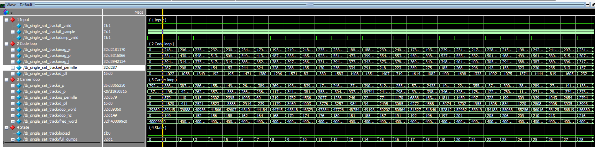
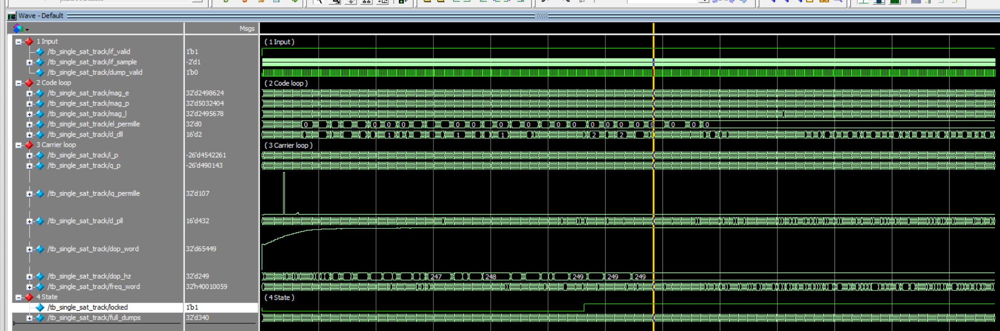
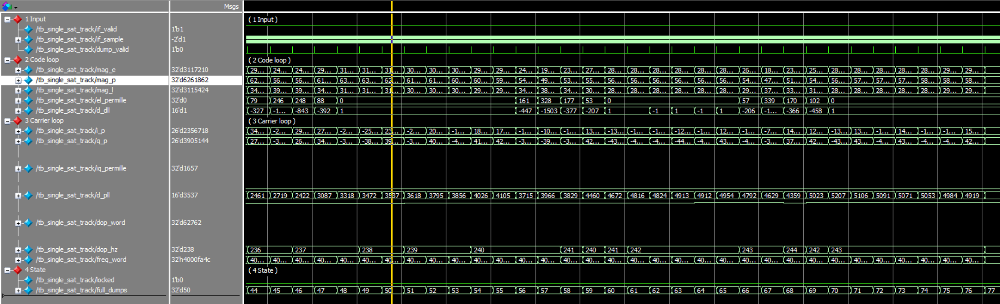
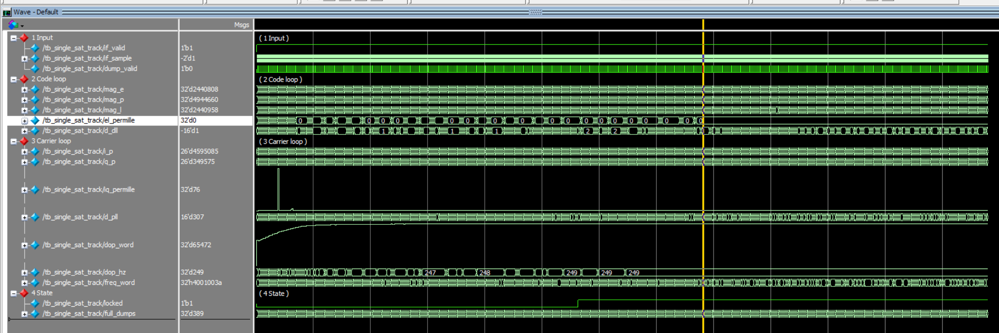
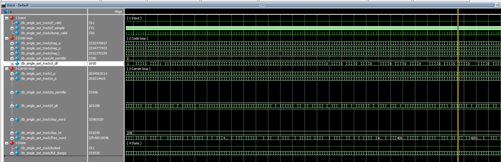

# 北斗 B1I 码跟踪与载波跟踪实验报告

## 1. 实验目的与条件

本实验检查已有跟踪通道在带多普勒的 B1I 中频上能否完成码跟踪和载波跟踪。激励使用教师学生包中的 `bdi_signal_source_doppler`，接收机使用现有 `tracking_channel`。仿真工具为 ModelSim SE-64 2020.4，有效样点时长 640 ms。

接收机只接入 `if_sample` 和 `if_valid`。信号源的 `dbg_*` 没有进入跟踪电路，也不作为锁定依据。`locked` 只作辅助指示。

| 项目 | 取值 |
|---|---|
| 信号源 | `bdi_signal_source_doppler` |
| PRN | 6 |
| 采样率 | 16.368 MHz |
| 标称中频 | 4.092 MHz |
| 载波多普勒 | +250 Hz，频控字 65600 |
| 码多普勒频控字 | 86，约 +0.33 Hz |
| 中频量化 | 有符号 2 bit |
| 初始码相位 | 相对发送相位 10 超前 0.15 chip |
| 初始多普勒字 | 39360，约 +150 Hz |
| E/L 间隔 | 0.5 chip |
| 仿真时长 | 640 ms 有效样点 |

发送相位 10 与捕获实验中读到的码相位一致。初始多普勒字比信号源低 26240，约 100 Hz。这个偏差留在环路外面，用来看载波环能不能自己拉入。

## 2. 判定方法

每个完整 1 ms 积分记录 Early、Prompt、Late 的幅度，以及载波 I、Q。幅度按 `|I| + |Q|` 计算。

- `el_permille = |E − L| × 1000 / (E + L)`。100 表示 E、L 相差 10%。
- `iq_permille = |Q| × 1000 / (|I| + 1)`。100 表示正交分量约为同相分量的 10%。
- 载波频率看多普勒字。65600 对应的真值约 249.99 Hz，ModelSim 里的整数 `dop_hz` 可能显示 249。判定用字，不用这个整数赫兹。

稳态条件是同一 1 ms 同时满足：

1. Prompt 幅度高于 Early，也高于 Late。
2. `el_permille` < 100。
3. `iq_permille` < 100。
4. 多普勒字与 65600 相差小于 3936，约 15 Hz。

第一个完整积分还要能看出初始误差：`el_permille` > 100，Prompt 幅度大于 1000，多普勒字仍为 39360。通过标准是有效样点超过 500 ms 之后，最后连续 100 ms 都满足上面四条。

## 3. 仿真步骤与复现

1. 复位后把 PRN 6 的本地码写入码 RAM。
2. 装入初始码相位和初始多普勒字 39360，然后释放信号源复位。
3. 信号源先预热 4 个码片，`if_valid` 为 0 时相关器和两个 NCO 都不前进。
4. 每个 1 ms 积分结束输出一组相关值，环路在随后的积分里更新码 NCO 和载波 NCO。
5. 仿真跑满 640 ms，脚本再按 CSV 复算最后 100 ms。

在仓库根目录执行：

```powershell
powershell.exe -NoProfile -ExecutionPolicy Bypass -File .\单星跟踪验收\run_demo.ps1 -NoGui
```

不加 `-NoGui` 时，脚本在检查通过后打开 ModelSim 波形。本次记录来自 2026-10-23 的一次通过仿真，日志和逐毫秒 CSV 在 `reports/sim/single_sat_track/run_20261023_161313_059/`。

## 4. 数值结果

共 639 个完整 1 ms 积分。第一个积分的 `el_permille` 为 287，多普勒字为 39360。最后一条记录的多普勒字为 65556，`el_permille` 为 0，`iq_permille` 为 30。最后连续 100 ms（第 539–638 个积分）全部满足第 2 节的四条。

| 项目 | 起始 | 结束 |
|---|---:|---:|
| 多普勒字 | 39360 | 65556 |
| 整数多普勒 / Hz | 149 | 249 |
| `el_permille` | 287 | 0 |
| `iq_permille` | 579 | 30 |
| Prompt | 5316066 | 4706490 |
| Early | 2181170 | 2335280 |
| Late | 3942134 | 2334616 |

结束时多普勒字比信号源的 65600 少 44，约 0.17 Hz，在 15 Hz 容差内。Prompt 约为 Early 和 Late 的两倍，Early 与 Late 相差不到 700。

中间几个时刻如下。时间用积分序号，单位为 ms。

| 时刻 / ms | `el_permille` | `iq_permille` | 多普勒字 | Prompt | Early | Late |
|---:|---:|---:|---:|---:|---:|---:|
| 0 | 287 | 579 | 39360 | 5316066 | 2181170 | 3942134 |
| 49 | 0 | 1657 | 62660 | 6201862 | 3117210 | 3115424 |
| 388 | 0 | 76 | 65470 | 4944660 | 2440808 | 2440958 |
| 525 | 0 | 46 | 65529 | 4777433 | 2370857 | 2370339 |
| 638 | 0 | 30 | 65556 | 4706490 | 2335280 | 2334616 |

第 49 ms 码环已经对齐，载波正交分量仍然很大，`iq_permille` 为 1657。载波误差继续下降，到第 525 ms 时 `iq_permille` 为 46。第 368–382 ms 附近 `el_permille` 从 0 短时抬到约 19，随后回到 0，没有破坏最后 100 ms 的连续条件。

I 路符号会随 NH 码和导航比特翻转。第 525 ms 的 Prompt I 为 +4563014、Q 为 +214419；第 638 ms 的 Prompt I 为 −4566388、Q 为 −140102。符号翻转不改变幅度和 `iq_permille`。

## 5. 波形记录

五张图都来自这次 ModelSim 仿真。时间轴单位为 ms。幅度和误差在放大窗口里用数字显示，长时窗口里 `dop_hz`、`el_permille` 用模拟波形看走势。`freq_word` 保持十六进制，避免模拟刻度把 250 Hz 淹没在中频字里。

### 5.1 初始误差



图 1  起始窗口。游标在第一个完整积分：`el_permille` 为 287，Early 2181170，Prompt 5316066，Late 3942134，多普勒字 39360，`dop_hz` 为 149，`freq_word` 为 `0x400099c0`。Prompt 已经最高，但 Late 明显高于 Early，码误差可见。多普勒字随后离开 39360。

### 5.2 载波拉入



图 2  载波拉入。`dop_hz` 由 149 经过 247、248 到达 249。游标附近 `dop_hz` 为 249，`freq_word` 为 `0x4001005b`，即中频字 `0x40000000` 再加上约 250 Hz。`d_pll` 先升高，频率到位后变平。

### 5.3 码环对齐



图 3  约 50–80 ms。游标处 `el_permille` 为 0，Prompt 6201862，Early 3117210，Late 3115424，`d_dll` 为 1。码环在载波尚未收完时已经把 E、L 对齐。

### 5.4 长时跟踪



图 4  0–640 ms。游标约在 389 ms：`el_permille` 为 0，Prompt 4944660，Early 2440808，Late 2440958。370 ms 附近 `el_permille` 有一次短时抬起，随后回到 0。整段里 Prompt 保持高于 Early 和 Late。

### 5.5 稳态放大



图 5  约 526 ms 的放大，不是仿真终点。游标处 `el_permille` 为 0，`d_dll` 为 0，Prompt 4777433，Early 2370857，Late 2370339，Prompt I 为 4563014，Q 为 214419，`iq_permille` 为 46，多普勒字 65529，`dop_hz` 为 249，`freq_word` 为 `0x4001004b`。这一窗同时满足 Prompt 居中、正交分量小于 10%、多普勒字落在 65600 附近。仿真结束时的第 638 ms 更紧：`iq_permille` 为 30，多普勒字 65556。

## 6. 实验结论

在无噪声、单星、载波多普勒固定为 +250 Hz 的条件下，跟踪通道从 0.15 chip 码相位误差和约 100 Hz 频率误差进入稳定跟踪。640 ms 仿真结束时，最后连续 100 ms 的 Prompt 高于 Early 和 Late，`el_permille` 为 0，`iq_permille` 降到 30，多普勒字为 65556。

本次没有加噪声，没有多星，没有变化的多普勒，也没有上板测量。I 路符号随 NH 码翻转是信号本身的行为。`dbg_*` 未接入跟踪电路，锁定与否由相关幅度、E/L 比、I/Q 比和多普勒字共同说明。
