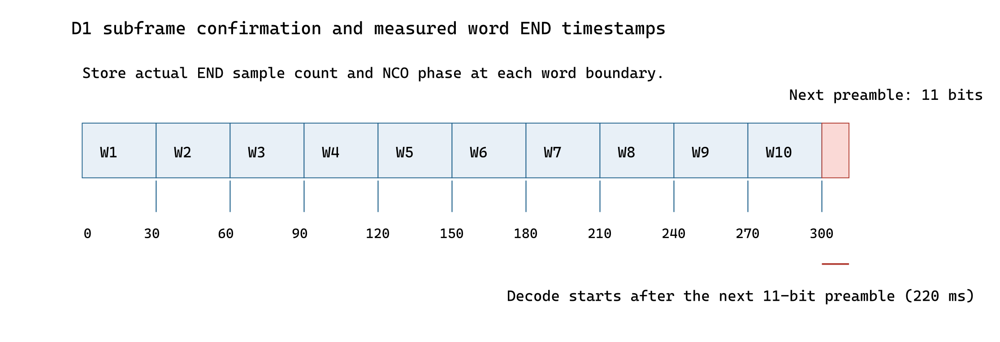
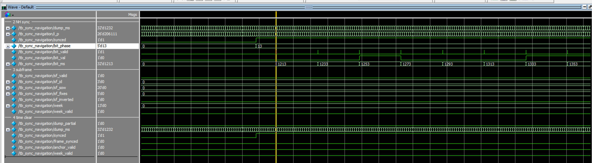
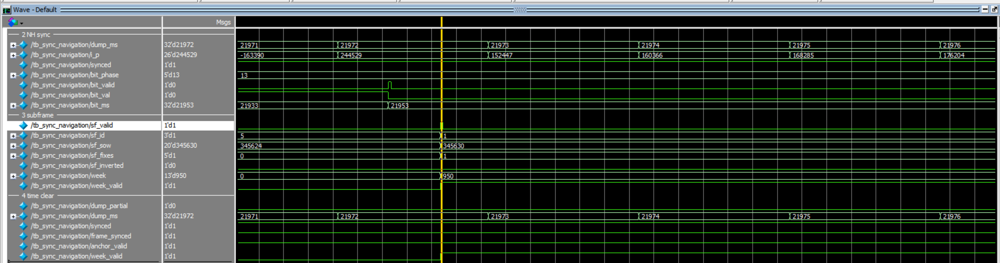
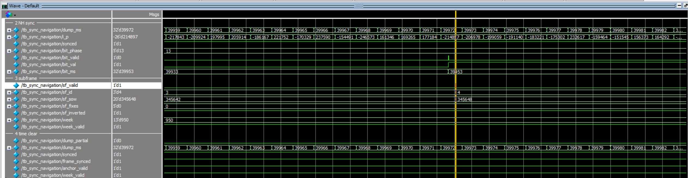
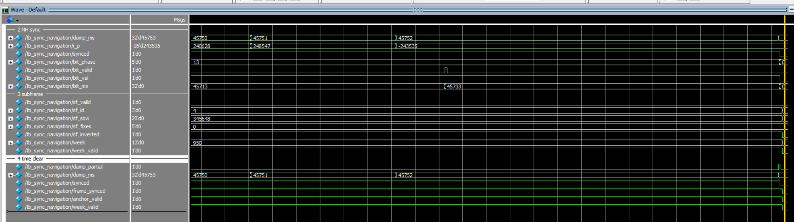

# 北斗 B1I 位同步与导航电文解调实验报告

项目组实验报告　2026 年 10 月 26 日；波形截于 2026 年 10 月 30 日

本实验实现北斗 B1I D1 信号的 NH20 位同步、导航位恢复、子帧同步及 BCH 单错纠正，并检查导航字结束时间的保留与时间状态的失效处理。Prompt 级联调实际恢复 5 个子帧和 50 个导航字，全部信息与参考向量一致；教师独立工具逐字复核通过。

## 1 实验目的与总体方案

导航信息位与 NH 二次码共同调制测距码。完成码和载波跟踪后，每个完整测距码周期产生一路 Prompt I 相关结果。本设计先识别 NH 的 20 个可能相位，再将一位内的 20 个相关结果按 NH 符号合并，以累加结果的正负恢复信息位；随后通过 D1 前导码、去交织和 BCH 译码恢复子帧。

| 处理层级 | 长度与周期 | 本实验检查目标 |
| --- | --- | --- |
| 测距码相关 | 标称 1 ms 一个完整 Prompt | 丢弃 partial；保留实际结束样本与码相位 |
| NH 二次码与数据位 | 20 个码周期；50 bit/s | 识别位边界、去 NH、位判决与质量输出 |
| D1 导航字 | 30 bit；标称 0.6 s | 首字特殊结构、普通字去交织及单错纠正 |
| D1 子帧 | 300 bit；标称 6 s | 224 bit 信息、FraID、SOW 与时间有效性 |

### 实验条件

RTL 基线为本次提交 7275347，仿真工具为 ModelSim SE-64 10.5。定向实验从 Prompt I 或导航位接口输入，不包含射频采样和捕获、跟踪的信号处理过程。联调 Prompt 的幅度为 ±200000，叠加由固定整数序列产生的 −50000～+50000 幅度扰动；该扰动用于检查符号判决，未将其换算为 C/N₀。

本次 7 项同步与电文定向测试全部通过，快速 RTL 回归 22 项及顶层冒烟 1 项也通过。定向用例属于快速回归子集，分别报告检查口径。所有数值取自实际执行的 RTL 仿真日志和独立译码结果，未使用板级实测数据。

## 2 NH 位同步设计与算法

NH20 序列按发送顺序为 00000100110101001110。模块保存最近 20 个完整 Prompt，每次新结果到达后复用一个加减累加器，在 20 个时钟内形成滑动相关值。NH 码位为 0 时相关结果取正，码位为 1 时取负。

C_m = sum(k=0..19) a_k x[m-19+k]；此处求和上限为 19。

式中 N=20，x[m] 为标签 m 对应的完整 Prompt I，k=0～19 为 NH 码位序号，aₖ 在 NH 码位为 0 时取 +1，否则取 −1。Cₘ 为对应 20 个完整窗口的相关和。相关计算包含第 20 个分量。

A_p ← A_p + |C_m|；p=(m+1) mod 20。

Aₚ 为候选位起点相位 p 的累计相关幅度。使用绝对值可以消除未知导航位正负号对相位评分的影响。默认 BS_BITS=10，20 个候选相位各累计 10 次后，串行比较最大与次大分数；最大分数非零且不小于次大分数的 2 倍时置位 synced。条件不满足时清除本轮分数并重新累计。

| 实现项 | 配置与含义 |
| --- | --- |
| 数据位边界 | bit_phase 为位起点码周期标签模 20 的结果 |
| 输入历史与运算 | 20 个 26 位有符号 Prompt；32 位有符号相关和 |
| 相位分数 | 20 组 40 位无符号累计相关幅度 |
| 相位判断条件 | 最大分数非零，且最大／次大不小于 2 |
| 串行调度约束 | 每个 dump 后至少 41 个空闲时钟，覆盖相关和最坏相位判断 |

同步后，当当前相关窗口与 bit_phase 对应时输出 bit_valid；Cₘ<0 判为 1，否则判为 0，同时给出 |Cₘ| 作为 bit_mag。位起点标签为 m−19，位结束样本计数和 48 位码相位取最后一个 Prompt 的实测元数据。整体反相由后续前导码判断，不影响 NH 边界搜索。

首个标签可从任意值开始。缺号、重复号、标签回绕或不完整窗口均使旧历史失效，防止将不连续的相关结果拼成一位。完整的新样本可以立即作为重建历史的第一个元素；clear 会同时取消正在执行的相关与相位判决。

## 3 D1 子帧同步与导航字译码

帧同步模块保留最近 311 位。两处相隔 300 位的 11 位前导码均为 11100010010，或均为其反码时，冻结前一个完整子帧，并确定整体极性。该方法需要等到下一子帧前导码的 11 位到达，判定时刻比上一子帧结束晚约 220 ms。

### 去交织与 BCH 单错纠正

g(X)=X⁴+X+1。

式中 X 为编码多项式的形式变量，g(X) 为 BCH(15,11,1) 的生成多项式。每 11 位信息形成 15 位码字，可纠正该码字中的一个错误。首字前 15 位不编码，后 15 位为一组码字，恢复 26 位信息；普通字由两组码字逐位交织，恢复 22 位信息。一个子帧共包含 19 组受保护码字，信息长度为 26+9×22=224 位。

译码器计算 4 位综合，用综合定位并翻转对应位，再复核校验关系。普通导航字的纠错计数为 0～2，表示两组码字中发生翻转的组数。sf_raw 保留经整体极性校正的原始发送位，sf_info 保存纠正后的信息。BCH 单错码不能保证检测双错或更多错误，多错可能被误纠为另一个合法码字。

### 导航字结束时间保留

若将译码完成时刻当作导航字结束时间，会把等待下一前导码的时间混入测量结果。模块因此用 311 深度循环历史保存每个位结束时的样本计数、48 位码相位与码周期标签，在译码时读取每个导航字第 30 位的元数据。

字段检查在 19 组码字完成后进行。FraID 只接受 1～5，SOW 只接受 0～604799。有效子帧提交时同时锁存信息、纠错计数、起点标签和时间锚点；有效子帧 1 还提取 13 位周数。

## 4 连续性与时间状态处理

为防止旧数据或错误时间继续进入测量链路，本次在输入窗口、数据位和子帧三个层级检查连续性。输入标签用于判定数据是否连续，空闲时钟用于完成串行计算，二者分别处理。暂停输入但不丢数据时，不推进失效计数。

| 检查层级 | 接受或失效条件 | 采取动作 |
| --- | --- | --- |
| NH 输入 | 完整 Prompt 标签应依次加 1 | 缺号、重复号、partial 或回绕时清除 NH 状态 |
| D1 位流 | 相邻 bit_ms 应相差 20，允许 32 位无符号回绕 | 取消旧子帧、译码流水和时间状态，重建位历史 |
| D1 子帧 | 相对上次有效起点增加 6000、12000 或 18000 | 同时核对 SOW 增加 6、12 或 18 秒与 FraID 循环 |
| 时间保持 | 连续 1200 个输入位无新有效子帧 | 撤销帧、时间锚点与周数有效标志 |
| 通道级状态 | NH 的 synced 失效 | channel_slice 同步清除 D1，撤销旧电文时间 |

SOW 按一周 604800 秒回绕，FraID 按 1～5 循环。允许跨一个或两个不能译码的子帧恢复，可以兼容本用例的整体反相切换。连续性检查由三个固定间隔比较展开，不引入通用除法器。1200 位保持期对应标称 24 s 的有效位输入；未继续接收位流时不会按墙钟时间自动到期。

第一个有效子帧仍由两处同极性前导码、BCH 译码及字段范围建立锚点。后续子帧才与该锚点比较，因此首次检出不能视为已确认多个连续子帧。失效后可以用新接收的有效候选重新建立时间。

### 实验方法

先保留原 NH、D1 和 clear 用例；再从公开输入接口注入非零首标签、输入缺号与重复号、合法 BCH 编码但时间或编号不一致的子帧，以及逐位单错。最后从带扰动的 Prompt I 串联 NH 与 D1，核对信息、极性、纠错及每个导航字的结束元数据。新增连续性与逐位纠错用例采用外部输入，不依赖强制内部译码结果。

## 5 定向仿真结果与分析

| 用例 | 本次结果 |
| --- | --- |
| 原 NH 位向量与 clear | PASS；59 位与参考一致，位结束元数据正确；旧状态不能在 clear 后提交 |
| 20 相位与异常输入 | PASS；全部 20 相位通过，合计核对 346 位；断流、partial 与重复标签后重新同步 |
| 原 D1 位向量与 clear | PASS；恢复 5 子帧，纠正 1 位；50 个导航字元数据与公共记录正确 |
| BCH 逐位错误注入 | PASS；285 个受保护发送位分别注入一个错误，均恢复正确的 224 位信息 |
| D1 连续性与失效 | PASS；拒绝不一致/越界字段；回绕、两帧漏译、保持期到期及重新捕获正确 |
| Prompt 至 D1 联调 | PASS；5 子帧、50 个字结束元数据、1 次纠错，后续失效传递正确 |

20 相位测试交替使用两种整体极性，并覆盖确定性幅度扰动、最大正负 26 位 Prompt 和零输入。非零首标签用例中，旧实现把真实相位 0 标成 18；修正后，标签相位与恢复位的起点一致。零输入没有建立同步。

D1 逐位测试覆盖首字受保护的 15 位及其余 9 字的 270 位，共 285 位；每次只翻转其中一位，并交替改变整体极性。测试同时检查 sf_raw 未被 BCH 改写、逐字纠错计数、起点标签和全部信息。综合异常与单错用例共核对 3020 组导航字结束元数据。

| 旧实现的可复现问题 | 本次修正结果 |
| --- | --- |
| 重复接收同一位标签后，旧时间锚点仍有效 | 重复标签后帧、时间及周数立即失效，新历史可重新恢复 |
| 已同步后，partial 或缺失窗口未清除 NH 历史 | 旧窗口丢弃，并通过完整新窗口重新建立 NH 同步 |
| 只检查 FraID/SOW 范围，范围内的错误时间仍可能被接受 | 合法 BCH 但 SOW 停滞或 FraID 不一致的候选被拒绝 |

快速回归 22／22 与顶层冒烟 1／1 的通过说明本次改动未在所覆盖的公共记录、背压和顶层控制用例中引入回归。上述结果为确定性功能检查，不能据此估计同步概率或误码率。

## 6 Prompt 至电文联调结果

联调用例输入 44750 个 Prompt 窗口，首个为不完整窗口。原始导航位向量含随机前缀、7 个子帧、一次受保护位错误和一次整体极性切换。接收电路只获得调制后的 Prompt I 及时间元数据；已知位向量仅用于测试台判定结果。

| 序号 | FraID | SOW 秒 | 起点标签 | 纠错数 | 反相 |
| --- | --- | --- | --- | --- | --- |
| 1 | 4 | 345618 | 3753 | 0 | 0 |
| 2 | 5 | 345624 | 9753 | 0 | 0 |
| 3 | 1 | 345630 | 15753 | 1 | 0 |
| 4 | 3 | 345642 | 27753 | 0 | 1 |
| 5 | 4 | 345648 | 33753 | 0 | 1 |

NH 锁定相位为 13，共恢复 2227 个可比较数据位，全部与输入参考一致。5 个有效子帧的 224 位信息、起点标签与整体极性均通过检查；累计纠正 1 位，并从子帧 1 提取周数 950。50 个导航字的结束样本计数和 48 位码相位，均等于对应最后一个 Prompt 的标签。

第 4 个输入子帧对应的前后前导码被整体反相切换分隔，不能满足同极性条件，因而不输出。最后一个输入子帧之后没有下一前导码，也不满足当前确认方式。实际结果从 FraID 1、SOW 345630 跳到 FraID 3、SOW 345642，间隔 12 s，与允许漏译一个子帧的连续性条件一致。

### 独立工具复核

| 复核对象 | 教师工具与结果 |
| --- | --- |
| Prompt 联调结果 | prompt_d1.decode_word 对 50 字重新去交织、纠错；信息和纠错数全部一致 |
| 新增字段测试向量 | 16 个子帧逐字复核，共 160 字；BCH 编码全部有效，异常字段确实由范围/连续性检查拒绝 |
| 公共记录输出 | validate_teacher_records 复核 50 条 NAVIGATION 与 1 条 END，恢复 5 个完整子帧 |

联调结束时再注入一个不完整 Prompt，NH 的 synced 撤销，随后 D1 的 frame_synced、anchor_valid 和 week_valid 全部撤销。这说明时间有效性随当前同步状态更新。

## 7 仿真波形记录

下面四张图来自 2026-10-30 的 ModelSim SE-64 2020.4 复现，波形文件在 `reports/sim/navigation/run_20261030_154025_778025/navigation.wlf`。7 项定向测试与教师独立译码均通过，游标读数与第 6 节的 5 个子帧一致。仿真把每个标称 1 ms Prompt 压缩为 61 个时钟，横轴是加速后的仿真时间；码周期时间看 `dump_ms`、`bit_ms` 和 `sf_sow`。

图 2　游标处 `synced` 为 1，`bit_phase` 为 13，`bit_valid` 为 1，`bit_ms` 为 1213。这是同步后判决出的第一个导航比特。其后 `bit_ms` 依次为 1233、1253、1273、1293，相邻差 20，对应每 20 ms 输出一位。

图 3　游标停在 `sf_valid` 为 1 的时刻。`sf_id` 为 1，`sf_sow` 为 345630，`sf_fixes` 为 1，`sf_inverted` 为 0，`week` 为 950，`week_valid` 为 1。左侧上一帧为子帧号 5、周内秒 345624、纠错数 0。这一帧的 224 位信息与发送向量 `e240551878101db2...` 一致，其中 1 位由 BCH 纠正。

图 3（续）　游标同样在 `sf_valid` 上。`sf_id` 为 4，`sf_sow` 为 345648，`sf_fixes` 为 0，`sf_inverted` 为 1。左侧是子帧号 3、周内秒 345642，同样为反相。接收到的原始比特极性相反，按前导码反相译码后，信息与发送向量 `e2411518c00c...` 一致。跨过极性切换的那一帧没有输出，所以子帧号从 1 直接到 3。

图 4　游标在仿真结尾，`dump_ms` 为 45753。数值栏中 `synced`、`frame_synced`、`anchor_valid`、`week_valid` 均为 0，子帧号和周数也被清为 0。最右侧尖峰是 `dump_partial`。尖峰左侧仍保持同步：子帧号 4，周内秒 345648，`week` 为 950。不完整窗口到达后，NH 同步与下游时间标志一起撤销；这几步只相隔一个时钟，在本图的时间尺度上落在同一位置。

## 8 结果讨论与实验结论

滑动 NH 相关与绝对幅度累计可以在给定输入条件下识别位边界，避免导航位符号使相位评分相互抵消。首标签、断流和不完整窗口检查，使参与每个位判决的 20 个 Prompt 来自连续码周期。整体反相由 D1 前导码校正，因此后半段反相数据仍能恢复出一致的信息。

导航字结束元数据来自输入采样过程，并经过位与子帧历史保留。独立复核表明，译码等待时间没有取代字结束时间。SOW 与 FraID 连续性检查进一步约束错误候选，1200 位保持期及 NH 失效传递避免旧时间永久保持有效。

实验覆盖 Prompt 与导航位接口的确定性功能行为。幅度扰动未对应规定的信道噪声模型；初次检出未额外要求多个连续子帧；BCH 多错误纠和弱信号同步概率仍需专项统计。完整公开 100 s 六星软件参考及既有完整工程继续保留，不能用本次 Prompt 级结果替代完整 RTL 射频输入链路或目标工艺综合的验证。

本次完成 NH 位边界恢复、去 NH 与数据位判决，完成 D1 子帧定位、去交织、单错纠正和时间字段提取。7 项定向测试、22 项快速回归及顶层冒烟通过；Prompt 级联调的 5 子帧、50 字与教师独立译码一致，达到本实验所设功能验收目标。

### 设计文件与复现实验

| 内容 | 项目内位置 |
| --- | --- |
| NH 位同步 | rtl/sync/nh_bit_sync.sv |
| D1 解调及通道连接 | rtl/sync/d1_frame_sync.sv；rtl/track/channel_slice.sv |
| 新增用例 | tb/unit/tb_nh_continuity.sv；tb/unit/tb_d1_robustness.sv |
| 联调与证据脚本 | tb/integration/tb_sync_navigation.sv；scripts/verify_sync_navigation.py |

在项目根目录执行 python scripts/gen_unit_vectors.py，再执行 python scripts/verify_sync_navigation.py。2026-10-26 的日志、数据和源码 SHA256 位于 reports/verification/sync_navigation_20261026。本报告第 7 节的波形来自 2026-10-30 的复现目录 reports/sim/navigation/run_20261030_154025_778025，打开入口为该目录中的 open_wave.cmd。

参考依据：北斗 B1I B2I 信号空间接口控制文件 2.1 版第 5.1.3 节、第 5.2.1 节及 D1 帧结构相关章节；教师新版工具 prompt_d1.py、decode_records.py；本次被测 RTL、测试向量和仿真日志。
