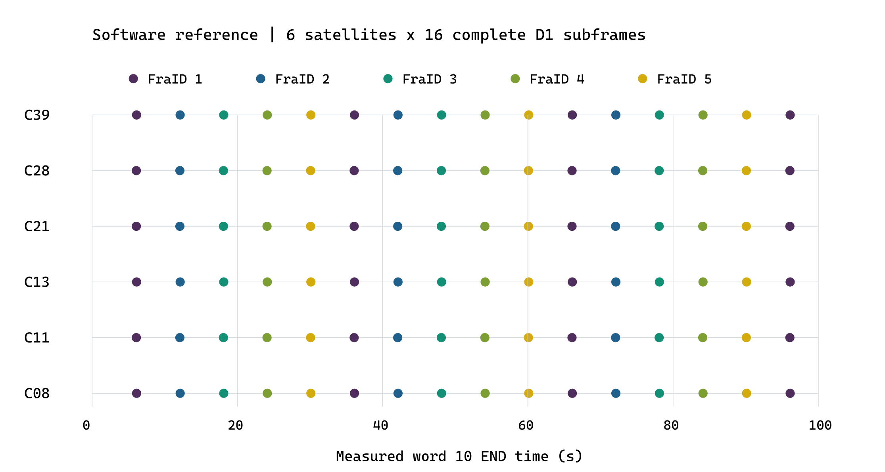
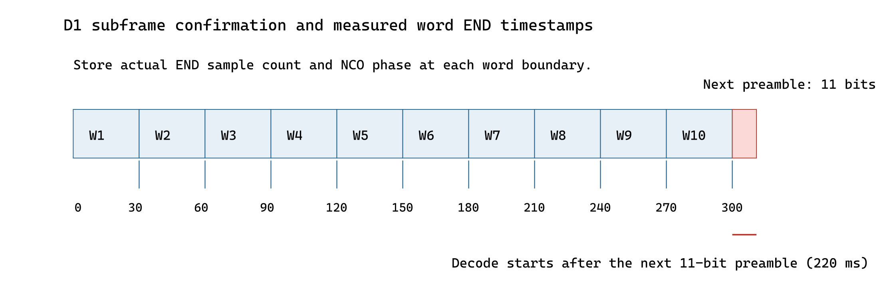

# 北斗 B1I 位同步与导航电文解调实验报告

项目组实验报告 · 2026-10-13 · 版本 2.1

摘要：设计通过 NH20 滑动相关恢复数据位，利用间隔 300 bit 的同极性前导码定位 D1 子帧，完成去交织、BCH 单错纠正与实测字结束时间保留。RTL 用例恢复 5 个子帧并通过教师独立译码检查；公开数据软件参考恢复六星共 96 个子帧、960 个导航字。报告说明算法、接口、结果分析及连续帧确认的现有边界。

## 1 实验目标与信号结构

本实验在码与载波跟踪提供的相关输出上恢复 NH 二次码相位、导航数据位及 D1 子帧，完成极性校正、去交织、BCH 单错纠正和时间字段提取。设计将信号处理、时间戳保留与公共记录输出分别组织，以确保译码完成时刻与导航字实际结束时刻能够区分。

| 层级 | 结构与周期 | 处理目标 |
| --- | --- | --- |
| 测距码 | 2046 chip；标称 1 ms | 获得完整码周期 Prompt |
| NH 二次码 | 00000100110101001110；20 个码周期 | 确定二次码相位并去 NH |
| 导航数据位 | 20 个完整 Prompt；50 bit/s | 相干合并后进行符号判决 |
| 导航字 | 30 bit；标称 0.6 s | 恢复首字或普通字信息 |
| D1 子帧 | 10 个导航字；300 bit；6 s | 前导码定位、BCH 译码、FraID 与 SOW 提取 |
| D1 主帧 | 5 个子帧；30 s | 按有效子帧号组织后续导航信息 |

本报告以 RTL 版本 2556e76 为实现基线。2026 年 10 月 13 日 ModelSim SE-64 10.5 回归 20／20 通过；既有图表与软件参考保留原实验来源。新版输入契约和独立联调证据见附录，原始日志版本标记保持不变。

## 2 模块连接与输入约定

channel_slice.sv 将 tracking_channel、nh_bit_sync 和 d1_frame_sync 串联。位同步输入包括 dump_valid、dump_partial、逐码周期标签和 Prompt I，并携带已处理样本计数及 48 位码相位。初始化后的不完整相关窗口被丢弃；后续 NH 相位以本地码周期标签确定，而非以接收机公共毫秒时钟替代卫星码边界。

NH 模块输出 bit_valid、bit_val、位起点码周期标签及位结束的实测元数据。D1 模块输出整个子帧的信息、原始位、各导航字纠错计数及导航字结束时间，公共编码器再将这些字段封装为 32 字节记录。位同步和帧译码内部使用有效脉冲接口，记录出口的背压由公共编码器队列与上游暂停机制承担。

## 3 NH 位同步与数据位判决

### 3.1 滑动相关搜索

NH 模块保存最近 20 个完整 Prompt I。每次码周期 dump 后，用 20 个时钟串行计算一次 NH 去码相关；NH 位为 0 时取 +1，为 1 时取 −1。该结构复用加减器，维护 20 个候选相位的分数，而非并行设置 20 个完整相关计算单元。

Cm = Σ h(k) I(m−19+k)

p=(m+1) mod 20；E[p] += |Cm|

其中 m 为当前码周期标签，p 为候选位起点相位。为降低导航数据正负号的影响，累计分数使用相关值的绝对值，分数存储宽度为 40 位。默认 BS_BITS=10，累计 200 次候选窗口更新后比较最佳分数与次佳分数；最佳非零且不小于次佳的 2 倍时建立同步，否则清分数重新搜索。

| 实现项 | 当前设置 |
| --- | --- |
| 历史长度 | 20 个 26 位 Prompt I |
| 单次相关计算 | 20 个时钟；32 位有符号相关和 |
| 相位分数 | 20 组 40 位绝对相关累计值 |
| 同步判决 | 200 次候选窗口更新；最佳／次佳 ≥ 2 |
| 首次判决所需输入 | 先建立完整历史，再累计分数；约 219 个完整码周期窗口 |
| 位输出 | 匹配锁定相位时输出最近完整 20 个窗口的符号与质量 |

### 3.2 完整位输出与清除

同步后仅在候选起点相位等于 bit_phase 时输出一个数据位，以相关和小于零判为 1，同时输出绝对相关幅度。整体位极性仍可能因 Costas 环的 180° 模糊翻转，留给帧前导码判定。clear 同时清除 Prompt 历史、候选分数、串行运算状态、锁定相位和元数据，防止通道释放或重新装载后沿用旧信息。

本次 tb_nh_bit_sync 输入 1400 个码周期窗口，期望位相位为 13，实际恢复 59 个可比较数据位，全部正确且位结束元数据一致。该用例仅验证所设相位及输入条件，不据此宣称已经遍历所有 NH 相位或完成弱信号同步概率统计。

## 4 D1 导航译码与帧同步

### 4.1 字结构与 BCH 单错纠正

g(X)=X⁴+X+1；(n,k,t)=(15,11,1)

普通 30 bit 导航字由两组 BCH(15,11) 码字逐比特交织形成，去交织后分别提取两组 11 bit 信息，合计 22 bit。首字前 15 bit 不受 BCH 保护，后 15 bit 作为一个 BCH 码字处理，共恢复 26 bit 信息。因此一个完整子帧的信息长度为 26+9×22=224 bit。

译码器计算 4 bit 综合，综合非零时按纠错 ROM 翻转对应位置，再复核纠正后的校验关系。普通字纠错计数为 0～2，表示两组受保护码字中发生翻转的组数。BCH(15,11) 可纠正每码字的一个错误，多比特错误可能映射为另一个合法码字；bch_valid 因而不能作为可靠双错检测标志。

### 4.2 子帧定位与字段有效性

d1_frame_sync 保存 311 bit 滑动历史。当相距 300 bit 的两个 11 bit 前导码均为 11100010010，或均为其反码时，冻结前一个完整 300 bit 子帧并确定极性。随后用 19 个受保护码字的串行译码步骤完成首字和其余 9 字的信息恢复。

| 检查或输出 | 当前行为 |
| --- | --- |
| 前导码条件 | 两处前导码间隔 300 bit，极性一致 |
| FraID | 仅接受 1～5 |
| SOW | 20 位字段；仅接受小于 604800 的值 |
| 输出信息 | 224 bit 信息；300 bit 极性校正后的原始位；10 字纠错计数 |
| 时间锚点 | 获得一个有效候选子帧后更新 anchor_ms 与 anchor_sow |
| 周数 | 在相应有效子帧中提取，并单独置 week_valid |

当前实现检查候选子帧的字段范围，尚未以相邻已译码子帧的 SOW 增加 6 s、FraID 循环连续作为额外确认条件，也未在长期缺帧时自动撤销已建立的时间有效标志。因此 frame_synced 和 anchor_valid 表示已获得至少一个符合现有条件的子帧，不能解释为已完成连续帧可靠性确认。

## 5 确定性 RTL 仿真结果

本次完整 RTL 回归 20／20 通过。同步与导航相关用例包括 tb_nh_bit_sync、tb_nh_clear、tb_d1_frame_sync、tb_d1_clear、tb_public_record_encoder 及 tb_record_backpressure。清除用例检查进行中的相关／译码被中止后，旧状态不得继续提交。

tb_d1_frame_sync 输入 2237 bit，含 7 个子帧和非整帧前缀；第 3 个子帧在受保护区域注入一个错误，第 5 个子帧开始前发生整体极性切换。实际输出 5 个子帧，结果如下。

| 输出序号 | FraID | SOW s | 起点标签 ms | 纠错数 | 反相 |
| --- | --- | --- | --- | --- | --- |
| 1 | 4 | 345618 | 3740 | 0 | 0 |
| 2 | 5 | 345624 | 9740 | 0 | 0 |
| 3 | 1 | 345630 | 15740 | 1 | 0 |
| 4 | 3 | 345642 | 27740 | 0 | 1 |
| 5 | 4 | 345648 | 33740 | 0 | 1 |

极性切换使其中一处前后前导码不能保持同极性，因此该候选不输出；最后一子帧之后没有新的前导码，尚不具备当前算法所需的完整确认条件，也不输出。实际 5 个子帧的 224 bit 信息、起点标签及正反极性均与独立向量一致，累计纠正 1 bit，并提取周数 950。

| 补充检查 | 验证结果 |
| --- | --- |
| 实测字结束元数据 | 50 个导航字的样本计数、48 位码相位和码周期标签与输入标签逐一一致 |
| 公共记录导出 | 50 条 NAVIGATION 记录＋1 条 END 记录 |
| 教师独立 BCH 校验 | 50 字信息与纠错计数一致；恢复 5 个完整子帧 |
| NH 清除与 D1 清除 | PASS；清除后旧相关或待提交子帧失效 |
| 输出背压 | PASS；记录在等待握手期间稳定，队列保持数据顺序 |

导航记录的独立校验使用 student_release1/student_release/tools/prompt_d1.py 与 decode_records.py，未以 RTL 自身的综合表作为唯一判据。该测试的输入为导航位向量，不包含 RF、捕获和跟踪链路，因此其正确性结论限于同步译码与记录封装。

## 6 公开 IF2 数据的软件解调实验

本次对公开 100 s 输入的 software_reference_records.bin 调用教师独立记录解码及 BCH 译码工具，逐字核验原始字、信息位、纠错计数、子帧字段、导航字序号及实测结束时间。

| PRN | 完整子帧数 | 导航字数 | SOW 首值／末值 s |
| --- | --- | --- | --- |
| 8 | 16 | 160 | 261000／261090 |
| 11 | 16 | 160 | 261000／261090 |
| 13 | 16 | 160 | 261000／261090 |
| 21 | 16 | 160 | 261000／261090 |
| 28 | 16 | 160 | 261000／261090 |
| 39 | 16 | 160 | 261000／261090 |

| 记录类型 | 数量 | 解释 |
| --- | --- | --- |
| TRACKING | 599 994 | 六星逐完整码周期的软件观测 |
| ACQUISITION | 6 | 软件搜索的检出事件 |
| NAVIGATION | 960 | 96 个完整子帧，每子帧 10 字 |
| 公共历元观测 | 600 | 有效标志为 1 的记录 528 条 |
| END | 1 | 实际样本总数 1 636 800 000 |

图 1　六星软件参考的完整子帧分布；点位置为第 10 字的实测结束时刻

960 个导航字全部通过独立 BCH 与字段一致性核验。六星 SOW 均从 261000 至 261090，以 6 s 间隔递增，为软件帧恢复提供一致性证据。528 条有效公共观测属于软件结果，不能用于评价当前 RTL 的多通道有效率或定位精度。

## 7 时间戳保留与公共输出

### 7.1 导航字实际结束时刻

当前帧判定需要等待下一前导码的 11 bit，译码启动比上一子帧结束晚 220 ms。若直接使用译码完成时的样本计数和码相位作为导航字结束时间，将把算法等待时间计入测量量。为避免该偏差，位同步在每个数据位结束时锁存实际样本计数与码 NCO 状态，D1 模块以 311 深度循环历史保存这些元数据。

图 2　前后前导码确认与导航字结束元数据的对应关系

启用 WITH_METADATA 后，每个历史元素保存 64 位样本计数、48 位码相位及 32 位码周期标签，共 144 位。在串行 BCH 译码过程中读取各字最后一位对应的历史元素，输出 10 组实测结束元数据；原始字先做整体极性校正，再与纠正后信息及逐字纠错计数分别保留。

### 7.2 记录封装与背压处理

public_record_encoder.sv 将导航结果封装为 256 bit、按小端字节输出的记录。NAVIGATION 包含 PRN、通道、实际样本计数、原始 30 bit 字、信息位、字号、FraID、SOW、纠错计数和码相位；TRACKING 使用版本 3 格式，保留 Prompt 相关值供独立解调检查。

编码器为多通道导航字与相关事件设置队列。record_valid 有效而 record_ready 无效期间保持当前记录不变，并通过上游 input_ready 约束新输入。END 仅在输入结束、内部流水与输出队列排空后产生。COMMON_OBSERVATION 按实际接受样本计数的一秒边界采集；输出有效标志由跟踪、NH、帧和时间状态共同约束。

公共历元定向测试将计数器预置到一秒边界附近，检查 16 368 000 样本处的快照和 NCO 状态；它属于边界功能验证，不能作为完整一秒或 100 s 原始数据处理的性能证明。

## 8 结果分析与验证范围

现有证据表明，NH 串行相关能够在给定相位输入下建立同步；D1 译码能够正确处理首字特殊结构、普通字去交织、单错纠正、极性切换及实测字结束时间；公共记录可以被教师独立工具解码。公开软件参考进一步恢复了六星共 96 个完整子帧。

当前 RTL 尚缺相邻子帧时间与编号连续性确认、长期缺帧自动失效以及多误码统计评价。这些限制与单错纠正码的能力边界有关，后续应增加连续性约束和明确的失效策略，并在不同 C/N₀、位错模式和载波极性变化条件下评估误同步概率。当前亦未提供全量公开文件经过完整 RTL 链路的六星导航结果。

## 9 实现文件与复现实验

| 功能 | 仓库内文件位置 |
| --- | --- |
| 每通道连接 | rtl/track/channel_slice.sv |
| NH 同步与数据位合并 | rtl/sync/nh_bit_sync.sv |
| D1 帧同步及 BCH 译码 | rtl/sync/d1_frame_sync.sv |
| 教师公共记录输出 | rtl/meas/public_record_encoder.sv |
| 软件参考模型 | sw/b1i_ref/d1_nav.py sw/b1i_ref/prn_b1i.py |
| 同步／清除测试 | tb/unit/tb_nh_bit_sync.sv；tb_nh_clear.sv tb/unit/tb_d1_frame_sync.sv；tb_d1_clear.sv |
| 公共输出及联调测试 | tb/unit/tb_public_record_encoder.sv tb/system/tb_record_backpressure.sv tb/integration/tb_teacher_receiver.sv |
| 独立记录检查 | scripts/validate_teacher_records.py student_release1/student_release/tools/prompt_d1.py |

在仓库根目录执行：python scripts/run_rtl_unit.py nh --sim modelsim；python scripts/run_rtl_unit.py d1 --sim modelsim。本次 RTL 导航 BIN 及完整日志存于验证资料_20261012；公开 100 s 软件记录仍位于 reports/public_run/software_reference_records.bin。

参考依据：B1I ICD 2.1 第 5.1.3、5.2.1 节；student_release1/student_release/submission/OUTPUT_REQUIREMENTS.md；当前同步 RTL、公开编码器与教师工具；本次仿真日志及独立校验结果。

## 附录 新版输入契约与联调验证

新版教师包位于 student_release1/student_release/。输入文件的采样参数和内容未变，修订的是 32 位传输所含样本数、位对顺序及 sample_index 步长。下表明确区分文件与总线契约，避免重复重排。

| 检查项 | 新版接口契约 |
| --- | --- |
| 总线与时序 | 32 bit＝16 个样本；[1:0] 最早；标签步长 16 |
| 文件与播放器 | 文件每字节 [7:6] 最早；播放器已转换总线排列 |
| 默认配置 | STREAM_MODE=2；TAG_STRIDE=16；只在 valid／ready 握手时计数 |

NH 和 D1 的时间标签由实际接受样本及本地码周期形成，不能把总线传输次数直接解释为样本数。新版适配保留位结束样本数和码相位传递。50 条 RTL 导航记录另经新版教师工具核验，恢复 5 个子帧；导航位向量试验的范围仍与整机 RF 链路分别列示。

| 验证项 | 结果与范围 |
| --- | --- |
| 逐样本顺序与背压 | 65 540 字节；262 160 样本；16 385 次传输；跨 64 KiB 边界，PASS |
| 短流整机输出 | 1 条 END；样本总数 262 160；输入／输出错误均为 0 |
| 兼容与错误配置 | 旧版短流 BIN 一致；错排列在第 2 个样本拒绝；无信号性能结论 |

2026 年 10 月 13 日完整 RTL 回归 20／20 通过；输入配置解析的 5 项检查通过。回归日志保留生成时 dfaeb88 与工作区修改标记，被测源码随后提交为 2556e76。既有仿真曲线和软件统计保留 2026 年 10 月 12 日的来源，不改写为新增全量实验。

短流数据仅约 16 ms，未产生成功捕获、锁定跟踪、导航或公共观测记录；其结论限于样本排列、握手、实际计数和结束处理。全量 100 s RTL 六星接收与目标工艺综合仍需独立验证。

复现入口：`scripts/run_teacher_receiver.py --max-bytes 65540 --stall-period 7`；独立采样顺序测试台：`tb/integration/tb_teacher_player_order.sv`；新证据目录：`验证资料_20261013/`。
