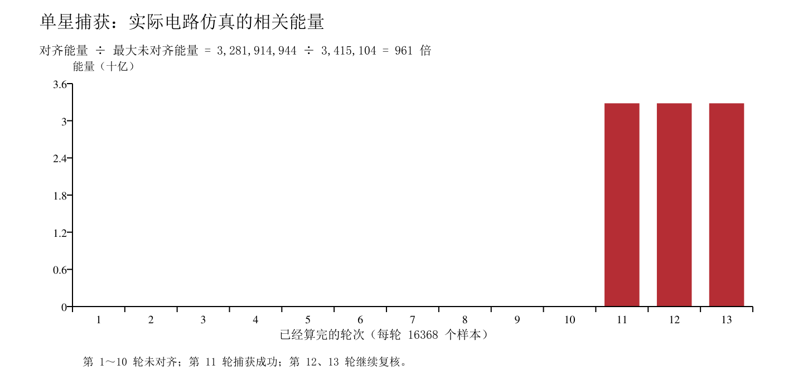
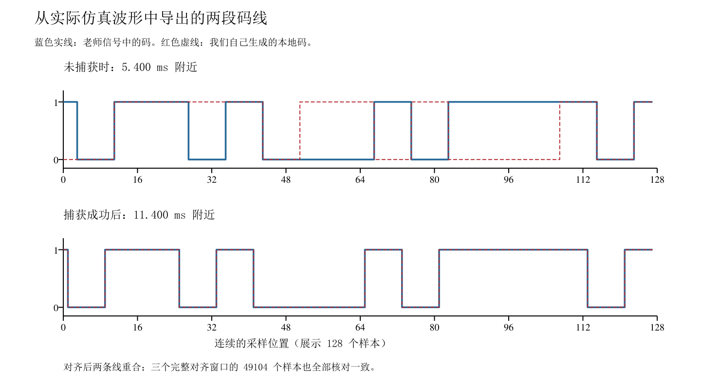

# 单星捕获验收讲解提纲

更新日期：2026-10-19。本次只展示一颗卫星的捕获过程，按下面步骤操作和讲解即可。

原完整接收机工程继续保留，完整讲解见 [原项目提纲](原完整项目讲解提纲_20261013.md)。原工程与单星方法见[捕获模块设计方案](01_捕获模块设计方案.docx)。单独的[实验报告](01_捕获模块实验报告.docx)已包含实验过程、结果与分析，保留四处波形截图空位供验收时补入。

要证明的事情是：**本地码没对齐时，相关能量小；对齐后，能量至少高 100 倍，并且捕获标志变为 1。** 当前实测是 **961 倍**。

## 1 怎样打开波形

1. 在资源管理器中进入 `D:\A_workfiles\codexwork\beidou\单星捕获验收`。
2. 双击 **打开验收波形.cmd**。
3. 等几秒钟，ModelSim 会打开已经算完的波形，只列出下面六个信号。

每次双击都会重新仿真。结果存在不同的运行目录中，已打开的旧波形不会被覆盖。

如果需要在终端运行，在项目根目录执行：

```powershell
powershell.exe -NoProfile -ExecutionPolicy Bypass -File '.\单星捕获验收\run_demo.ps1'
```

## 2 只看这六个信号

| 波形名称 | 你可以怎样理解 | 验收看什么 |
| --- | --- | --- |
| `signal_code` | 老师信号里的那串 0 和 1 | 与下面的本地码比较 |
| `local_code` | 我们自己生成、正在尝试的那串 0 和 1 | 成功后，两条线的电平和跳变位置重合 |
| `result_phase` | 刚算完的这一轮用了哪个起始位置 | 结果依次是 0～9，随后是 10、10、10 |
| `energy` | 两串码比对并累加后的相关能量 | 前 10 次小，第 11 次大幅增加 |
| `dump` | 这一轮已经算完的提示 | 每算完 16368 个有效样本闪一下 |
| `capture` | 已经找到正确位置 | 前面是 0，第 11 轮算完后变 1，并保持 |

`result_phase` 与 `energy` 是同一次计算的结果。电路算完一轮后会开始下一次尝试，所以先用总览看结果，再放大看两条码线。

## 3 按顺序展示三个画面

以下命令直接粘贴到 ModelSim 下方的 **Transcript** 输入区，按回车即可。

**画面一：搜索全过程。**

```tcl
wave zoom range 0ns 14000000ns
```

指着 `energy`、`result_phase` 和 `capture` 讲：前 10 轮分别尝试位置 0～9，能量都低；第 11 轮尝试位置 10，能量明显升高，`capture` 变为 1。后面又算了两轮，能量保持在高值。

| 比较项 | 实际结果 |
| --- | --- |
| 前 10 轮中最大的未对齐能量 | 3,415,104 |
| 对齐后的能量 | 3,281,914,944 |
| 两者的比值 | 961 倍，大于要求的 100 倍 |
| 第一次成功 | 第 11 轮，起始位置 10 |
| 后续复核 | 第 12、13 轮仍对齐，能量保持高值 |



**画面二：还没有对齐。**

```tcl
wave zoom range 5400000ns 5405000ns
```

指着 `signal_code` 和 `local_code` 讲：两条码线有多处不重合；此时相关能量为 3,415,104，捕获标志仍是 0。

**画面三：已经对齐。**

```tcl
wave zoom range 11400000ns 11405000ns
```

指着两条码线讲：现在电平和跳变位置重合，能量为 3,281,914,944，捕获标志为 1。这里看到的是成功后的保持阶段。



图中蓝色实线是信号码，红色虚线是本地码。成功后三个完整窗口共比较了 49104 个样本，没有发现两条码线不同的样本。

如果想看 `capture` 从 0 变成 1 的瞬间，使用：

```tcl
wave zoom range 11100000ns 11150000ns
```

## 4 关键代码只看一个文件的三个位置

双击验收目录里的 **打开关键代码.cmd**，打开的就是 [捕获代码](../../rtl/acq/bdi_sliding_correlator.sv)。用 `Ctrl+F` 搜索下面的文字即可定位。

**第一处：搜索 `index_sum =`，约第 68 行。**

这里决定本地码从哪里开始取。起初从位置 0 开始，失败一次就向后移动一个位置。码里的每一个 0 或 1，都保持 8 个输入采样点。

**第二处：搜索 `square_i =`，约第 84 行。**

这里把两路累加结果分别平方，再加起来，得到 `energy`。两条码对上时，累加结果大，因此能量也大。能量来自电路计算，波形直接显示计算结果。

**第三处：搜索 `if (sample_in_window ==`，约第 110 行。**

这一段在每轮 16368 个有效样本全部收齐后执行。先保存能量、这轮的位置和 `dump`，再判断是否成功：

```verilog
if (!capture && next_energy >= ENERGY_THRESHOLD) begin
    capture <= 1'b1;
    capture_phase <= candidate_phase;
end
```

意思是：能量达到门限，就记下成功，并保存找到的位置。位置 10 是逐次尝试得到的，判断成功的这几行只比较能量和门限。

老师如果要看信号怎么接进来，再打开 [演示连接文件](../../单星捕获验收/tb_single_sat_capture.sv)：`signal_source` 是老师的信号源，`receiver` 是我们的捕获电路。信号源给捕获电路的是 `if_sample` 和 `if_valid`；显示用的信号码另外接到波形中用于核对。

## 5 可以直接照着讲

“我们接收老师提供的单星信号，在本地生成同样的码，从不同起始位置逐次尝试。每次比较一段 1 毫秒的数据。没对上时，累加结果较小；第 11 次尝试到位置 10 时，两条码对齐，相关能量明显升高，捕获标志变成 1。最大未对齐能量是 3415104，对齐后是 3281914944，相差 961 倍，超过两个数量级。后面又验证了两轮，码仍对齐，能量保持在高值。”

## 6 老师追问时的简短回答

| 问题 | 回答 |
| --- | --- |
| 为什么是第 11 次才找到位置 10？ | 从 0 开始试，所以试到 10 是第 11 次。 |
| 为什么每次比较 1 ms？ | 老师这个信号的一整周期码需要 16368 个样本，正好约 1 ms。 |
| 能量怎么算？ | 两路累加结果各自平方，再相加。这里比较的是相关后的能量。 |
| 门限是多少？ | 能量门限为 67,108,864，介于当前未对齐值和对齐值之间。 |
| 成功后为什么还显示 1？ | 捕获成功会被记住；后两轮继续比较，用来确认能量和码线保持一致。 |
| 怎么重新演示？ | 重新双击“打开验收波形.cmd”，会从头仿真。 |

完整逐轮数字见 [验收数据](../../单星捕获验收/验证资料/capture.csv)，自动核对结果见 [验收结果](../../单星捕获验收/验证资料/result.json)。
