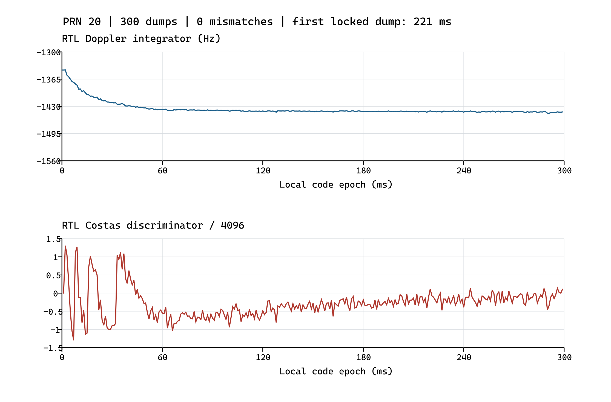
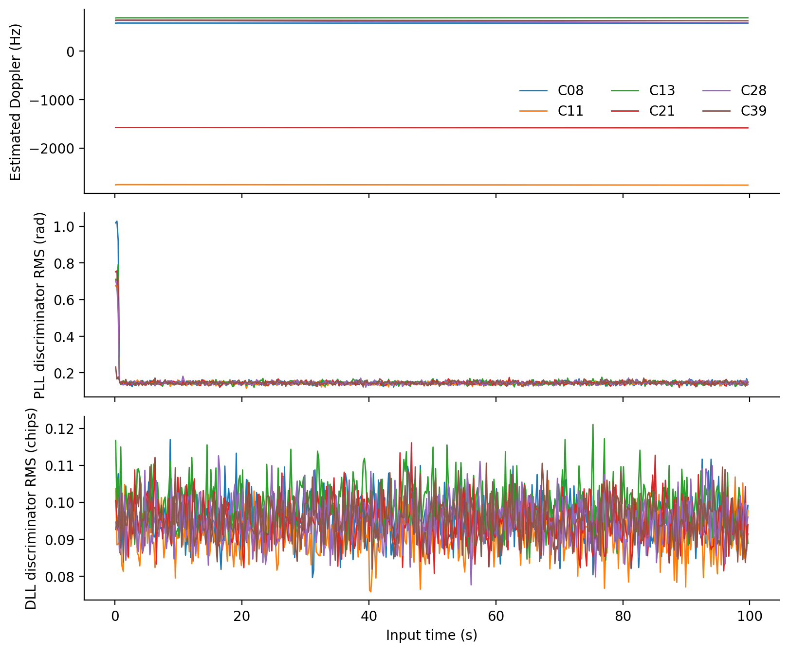

# 北斗 B1I 码跟踪锁频锁相环设计与仿真报告

项目组实验报告 · 2026-10-13 · 版本 2.1

摘要：单通道集成 48 位码 NCO、E／P／L 相关器、归一化 DLL、FLL 与 Costas PLL。300 ms 合成输入下的 4800 次字段比较全部一致并进入锁定，捕获移交用例进一步验证闭环收敛；公开 100 s 软件参考用于分析六星长期跟踪行为。报告明确列示定点结构、环路时序及实验结论。

## 1 设计目标与实验条件

跟踪模块在捕获初值的基础上持续估计载波频率、载波相位和测距码相位，为 NH 同步与导航电文解调提供逐码周期的 Prompt 相关结果。本设计在一个可复制通道内集成 DLL、FLL 与 Costas PLL，通过幅度归一化降低输入功率变化对鉴别器增益的影响，并以载波频率估计辅助码率调整。

| 参数 | 设计设置 |
| --- | --- |
| 采样率／中频 | 16.368 MHz／4.092 MHz |
| 码率／码长 | 2.046 Mchip/s／2046 chip |
| 相关积分边界 | 本地码 NCO 回绕；标称约 1 ms |
| E／L 相对 Prompt 偏移 | +0.5 chip／−0.5 chip |
| 通道数量 | 顶层可复制为 12 路；单通道闭环独立 |
| 实现与仿真基线 | RTL 2556e76；ModelSim SE-64 10.5；2026-10-13 |

本报告以 RTL 版本 2556e76 为实现基线。2026 年 10 月 13 日 ModelSim SE-64 10.5 回归 20／20 通过；既有图表与软件参考保留原实验来源。新版输入契约和独立联调证据见附录，原始日志版本标记保持不变。

## 2 通道结构与数据表示

输入样本经载波混频后，按 E／P／L 三个本地码抽头分别累加，得到六路 I／Q 相关值。track_loop.sv 统一完成归一化、鉴别、滤波和锁定判决；tracking_channel.sv 在码周期边界提交新 NCO 参数。

| 对象 | 表示与用途 |
| --- | --- |
| 载波 NCO | 32 位相位累加器；频率字 W 对应 W·Fs/2³² Hz |
| 载波查表与混频 | 1024 点、10 位正弦／余弦；3 位有符号样本；13 位乘积 |
| 码 NCO 内部相位 | 48 位 Q11.37；周期 2046×2³⁷；标称增量 2³⁴ |
| 相关累加器 | E／P／L 各两路，共 6 路 26 位有符号累加 |
| 对外兼容码相位 | 内部 48 位相位取高 32 位，表示 Q11.21 |

## 3 码跟踪环设计

### 3.1 相关幅度与归一化

各抽头采用 |I|+|Q|/2 近似复相关幅度，以降低平方、开方电路开销。Prompt 幅度估计使用移位为 3 的指数平滑，初始化时取首个完整窗口的幅度；归一化分母设置不低于 64 的下限，避免弱信号或零输入导致数值发散。

MX = |IX| + |QX|/2

Âk = Âk−1 + (MP,k−Âk−1)/8

硬件根据平滑幅度的最高有效位与 5 位尾数索引 32 项倒数表，再用共享乘法器和可变右移完成归一化，输出饱和至 16 位。归一化相关量的满幅标度约为 4096；该方法是有限精度倒数近似，不等同于精确除法。

### 3.2 DLL 鉴别与滤波

dDLL = norm(ME−ML)

DLL 利用 Early 与 Late 的幅度差估计本地码相位误差。当前 RTL 以相位推进方向定义 E=P+0.5 chip、L=P−0.5 chip，并将比例项和积分项以正号加入码 NCO 增量。该符号关系必须与 NCO 和码抽头定义共同说明；交换 E／L 命名后不能沿用同一反馈符号。

ucode = 2³⁴ + uaid + uDLL,P + uDLL,I

DLL 比例与积分系数分别取 2099、4，按 Q8.8 解释。积分状态限幅至 ±131072。载波辅助项由多普勒积分频率字与系数 2749 相乘后算术右移 16 位得到，用于补偿载波多普勒所对应的码率变化。码相位仅在有效样本被处理时更新，输入停顿不会引起物理时间漂移。

| 环路项 | 默认整数系数 | 定点格式 |
| --- | --- | --- |
| DLL 比例／积分 | 2099／4 | Q8.8 |
| PLL 比例／积分 | 6685／134 | Q2.14 |
| FLL 辅助 | 6685 | Q2.14 |
| 归一化输出标度 | 约 4096 | 12 位标度；16 位有符号输出 |

## 4 锁频环与锁相环设计

### 4.1 FLL 频率鉴别

FLL 使用相邻完整 Prompt 窗口的归一化 I／Q 相关值构成叉积与点积。用点积的符号校正叉积，可降低数据符号翻转引起的 180° 极性变化影响。首个完整窗口没有前一窗口，FLL 鉴别输出置零；之后保留前一组相关值参与计算。

Ck = Ik−1 Qk − Ik Qk−1；Dk = Ik−1 Ik + Qk−1 Qk

dFLL = sat16[sgn(Dk) Ck / 2¹²]

RTL 使用点积符号与移位近似进行频率鉴别，未实现 atan2 运算。其输出是归一化定点鉴别量，不是直接以 Hz 表示的频率误差。FLL 使能由通道配置控制；本次单通道用例始终使能，捕获移交用例在跟踪 200 ms 后关闭，公开接收机包装层当前保持使能。

### 4.2 Costas PLL 相位鉴别

dPLL = sgn(Ik) Qk

Costas 鉴别器利用 Prompt I 的符号修正 Q，从而消除数据位整体反相对鉴相方向的影响，但仍保留 180° 载波相位模糊，由后续导航前导码确定极性。符号函数在输入大于或等于零时取 +1，否则取 −1。PLL 积分项与 FLL 辅助项分别乘以相应系数、算术右移 14 位后累加到载波频率积分器；各乘积的截断在求和前执行，与定点参考模型保持一致。

载波频率字由中频字 2³⁰、频率积分状态和 PLL 比例项构成。积分状态限幅至 ±2 883 584，约对应 ±10.99 kHz 多普勒范围。上述系数的量纲同时取决于鉴别器标度与频率字分辨率，不能将整数系数直接等同为模拟环路带宽。

## 5 环路更新时序与锁定判决

每次完整窗口触发更新后，28×17 位共享乘法器按步骤完成归一化与滤波，控制序列经步骤 1～13 返回空闲。窗口 j 的观测值在该窗口结束后计算，并在下一次码周期边界提交，用于窗口 j+2；没有在当前边界对新系数进行即时旁路。首个不完整窗口仍输出 dump，但不更新环路。

锁定检测每累计 20 次完整更新比较 Σ|Ip| 与 2Σ|Qp|。满足条件时计数加 1，否则减 1，范围为 0～10；达到 5 后置锁定，回到 0 才清锁，形成滞回。该标志用于内部状态管理，不能单独证明位同步、帧同步或导航时间有效。

## 6 RTL 仿真设置与结果

### 6.1 单通道定点一致性实验

tb_tracking_channel 使用 PRN 20 的 B1I 测距码，输入时长 300 ms，C/N₀ 为 45 dB-Hz，随机种子为 7。初始码相位误差为 +0.3 chip，初始多普勒误差为 +100 Hz。合成真值仅用于向量生成和测试台评价，通道运行过程中使用输入样本、已加载码表与初始状态。

| 检查项 | 实验结果 |
| --- | --- |
| 输入规模 | 1 227 600 字节；4 910 400 样本 |
| dump 数量 | 300；包含 1 个初始化后的不完整窗口 |
| 比对项目 | 码周期标签、部分窗口标志、六路相关值、码相位、频率字、多普勒积分、锁定计数及三类鉴别器 |
| 逐字段结果 | 每窗口 16 项，共 4800 次字段比较；0 次不一致 |
| 最终状态 | locked=1；本次观测首次 locked dump 为 221 ms |

图 1　PRN 20 合成输入的 RTL 载波积分频率与 Costas 鉴别量

图中数据直接来自 RTL dump 观测，并由原测试台继续进行逐字段校验。鉴别器除以 4096 后仅表示归一化数值，不能直接解释为相位误差的弧度值。模型与 RTL 的逐位一致性覆盖位宽、截断、更新延迟和锁定状态；模型与实现共有的算法假设仍需独立信号实验检验。

### 6.2 捕获移交后的闭环跟踪

tb_acquisition 将捕获输出直接装载至 tracking_channel，在连续输入下继续跟踪 PRN 10。该实验独立检查粗频差、码初相及移交参考时刻能否被环路消化，避免仅以人为接近真值的初始条件验证跟踪通道。

| 输入时刻 ms | 码误差 chip | 多普勒积分误差 Hz | locked |
| --- | --- | --- | --- |
| 150 | +0.0358 | −7.48 | 0 |
| 200 | +0.0476 | −2.16 | 0 |
| 250 | +0.0441 | −2.67 | 0 |
| 300 | +0.0385 | −1.35 | 0 |
| 350 | +0.0276 | −0.35 | 0 |
| 400 | +0.0122 | +0.05 | 1 |
| 450 | −0.0025 | +0.03 | 1 |
| 500 | +0.0030 | −0.05 | 1 |

图 2　捕获移交实验的码相位与多普勒积分误差

捕获约在 109 ms 移交，随后 300 ms 跟踪结束时锁定有效，码误差为 0.0058 chip，满足用例所设 ±0.1 chip 限值。表中多普勒误差比较的是 dop_word 对应的频率积分项；实际载波 NCO 频率字另包含 PLL 比例项，两者不应混称。该试验为单一信号场景下的闭环收敛证据，未用于给出统计灵敏度或极限动态范围。

## 7 公开数据的软件跟踪参考

保存的软件参考对公开 IF2 文件处理 100 s，六颗卫星各保留 99 999 个完整码周期观测。浮点软件采用幅度精确计算、相位反正切鉴别及不同的环路调度，不能逐拍等同于当前定点 RTL。本节仅用于说明公开采样的可跟踪性和长期输出行为。

| PRN | 末 5 s 多普勒均值 Hz | Costas 鉴别 RMS rad | DLL 鉴别 RMS chip |
| --- | --- | --- | --- |
| 8 | 579.58 | 0.1448 | 0.0951 |
| 11 | -2764.13 | 0.1447 | 0.0936 |
| 13 | 690.40 | 0.1411 | 0.0967 |
| 21 | -1582.89 | 0.1439 | 0.0937 |
| 28 | 588.59 | 0.1446 | 0.0951 |
| 39 | 628.20 | 0.1475 | 0.0935 |

统计区间为输入时间不小于 95 s 的 5000 个观测，RMS 为鉴别器输出平方均值的平方根，数值由 tracking_prn*.npz 重新计算。六星多普勒连续，后续解调得到有效 D1 子帧。鉴别器 RMS 包含噪声与偏置，未与教师真值作差，不能作为绝对相位或测距误差。

图 3　100 s 软件参考的多普勒与分段鉴别器 RMS；属于浮点软件结果

本节浮点软件曲线仅对应公开静态、无中断场景；动态应力与失锁恢复性能须另行验证。

## 8 验证范围与结果讨论

当前验证支持以下结论：在给定 PRN 20 初始误差条件下，RTL 与定点模型逐字段一致并进入锁定；在 PRN 10 捕获移交条件下，DLL 与载波环闭环收敛；在输入停顿和输出背压用例中，公共计数与记录序列保持一致。12 通道结构及管理逻辑已连接至整机顶层，但单通道收敛结果不替代多通道全量公开数据验收。

后续应覆盖不同 C/N₀、初始码频误差及频率变化率，统计牵入时间、失锁概率与稳态鉴别器分布。还应评估持续 FLL 辅助与牵入后关闭两种配置，依据独立信号结果确定切换策略。现阶段没有使用综合面积、静态时序或实测硬件数据证明实现性能。

## 9 实现文件与复现实验

| 功能 | 仓库内文件位置 |
| --- | --- |
| 单通道集成 | rtl/track/tracking_channel.sv |
| DLL／FLL／PLL 及锁定检测 | rtl/track/track_loop.sv |
| 载波与码 NCO | rtl/track/carrier_mixer_nco.sv rtl/track/code_nco.sv |
| 码存储与相关积分 | rtl/track/code_ram.sv rtl/track/correlator_epl.sv |
| 参数与载波查表 | rtl/include/b1i_params.svh rtl/common/carrier_lut.sv；carrier_lut_table.svh |
| 定点模型与向量 | sw/b1i_ref/tracking_model.py scripts/gen_track_vectors.py |
| 测试台 | tb/system/tb_tracking_channel.sv tb/system/tb_acquisition.sv |

在仓库根目录执行：python scripts/run_rtl_unit.py tracking_channel --sim modelsim；捕获移交执行：python scripts/run_rtl_unit.py acquisition --sim modelsim。输入条件保存在 tb/vectors/track_meta.json 与 acq_meta.json；本次曲线数据与日志保存在验证资料_20261012 目录。

参考依据：student_release1/student_release/input/input_contract.json；B1I ICD 2.1 的信号与码结构规定；当前 tracking_channel.sv、track_loop.sv、b1i_params.svh 和 tracking_model.py；本次 RTL 回归与公开数据软件观测。

## 附录 新版输入契约与联调验证

新版教师包位于 student_release1/student_release/。输入文件的采样参数和内容未变，修订的是 32 位传输所含样本数、位对顺序及 sample_index 步长。下表明确区分文件与总线契约，避免重复重排。

| 检查项 | 新版接口契约 |
| --- | --- |
| 总线与时序 | 32 bit＝16 个样本；[1:0] 最早；标签步长 16 |
| 文件与播放器 | 文件每字节 [7:6] 最早；播放器已转换总线排列 |
| 默认配置 | STREAM_MODE=2；TAG_STRIDE=16；只在 valid／ready 握手时计数 |

载波和码 NCO 每接受一个有效样本推进一次，播放器或输出停顿不消耗样本时间。新版传输解包必须提供 16 个连续样本且保持顺序，环路的实际积分边界及反馈延迟由内部单样本时序决定；300 ms 逐字段闭环用例继续构成跟踪算法证据。

| 验证项 | 结果与范围 |
| --- | --- |
| 逐样本顺序与背压 | 65 540 字节；262 160 样本；16 385 次传输；跨 64 KiB 边界，PASS |
| 短流整机输出 | 1 条 END；样本总数 262 160；输入／输出错误均为 0 |
| 兼容与错误配置 | 旧版短流 BIN 一致；错排列在第 2 个样本拒绝；无信号性能结论 |

2026 年 10 月 13 日完整 RTL 回归 20／20 通过；输入配置解析的 5 项检查通过。回归日志保留生成时 dfaeb88 与工作区修改标记，被测源码随后提交为 2556e76。既有仿真曲线和软件统计保留 2026 年 10 月 12 日的来源，不改写为新增全量实验。

短流数据仅约 16 ms，未产生成功捕获、锁定跟踪、导航或公共观测记录；其结论限于样本排列、握手、实际计数和结束处理。全量 100 s RTL 六星接收与目标工艺综合仍需独立验证。

复现入口：`scripts/run_teacher_receiver.py --max-bytes 65540 --stall-period 7`；独立采样顺序测试台：`tb/integration/tb_teacher_player_order.sv`；新证据目录：`验证资料_20261013/`。
